# Jarkom Modul 4: Serial Experiments Lain, The Wired Expansion

**Kelompok K-68, Praktikum Komunikasi Data dan Jaringan Komputer 2026**

| | |
|---|---|
| Prefix IP | `192.245` |
| Blok akar hasil perhitungan | `192.245.0.0/18` |
| Controller GNS3 | Group C, `http://10.4.89.250/` |

| Nama | NRP | Bagian |
|---|---|---|
| Ryan Adya Purwanto | 5027231046 | GNS3, metode CIDR |
| Made Gde Krisna Wangsa | 5027201047 | Cisco Packet Tracer, metode VLSM |

Laporan ini mencakup **bagian CIDR dan GNS3**.

## Daftar Isi

- [Membaca Topologi](#membaca-topologi)
- [Menentukan Kebutuhan IP Tiap Subnet](#menentukan-kebutuhan-ip-tiap-subnet)
- [Penggabungan CIDR](#penggabungan-cidr)
- [Menurunkan Pohon dan Alokasi Alamat](#menurunkan-pohon-dan-alokasi-alamat)
- [Hasil Pembagian IP](#hasil-pembagian-ip)
- [Membangun Topologi GNS3](#membangun-topologi-gns3)
- [Konfigurasi Router](#konfigurasi-router)
- [Konfigurasi Node Host](#konfigurasi-node-host)
- [Pengujian](#pengujian)
- [Kesimpulan](#kesimpulan)

---

## Membaca Topologi

Topologi terdiri dari 13 router, 13 switch, dan 25 node host, ditambah satu NAT. Cyberia adalah satu-satunya router yang tersambung ke NAT.

Langkah pertama adalah menghitung ada berapa subnet. Satu subnet terbentuk pada setiap domain broadcast, yaitu:

- Setiap segmen LAN, yaitu router menuju switch menuju host
- Setiap host yang tersambung langsung ke router tanpa switch
- Setiap link antar router

Hasilnya **25 subnet**, terdiri dari 16 segmen LAN dan 9 link antar router.

Dua hal yang perlu diperhatikan saat membaca topologi ini:

1. **Switch2 adalah satu segmen bersama empat router**, yaitu Wired, Psyche, Copland, dan Schumann. Kalau dibaca sebagai tiga link terpisah, akan terbentuk tiga subnet mubazir dan pembagian IP menjadi tidak efisien
2. **Satu node host mewakili banyak host.** Karl bertuliskan 700 host, tetapi yang dibuat tetap satu node. Angka itu hanya dipakai untuk menghitung ukuran subnet

Gambar di bawah memetakan 25 subnet tersebut pada topologi soal. Setiap elips adalah satu subnet, dan penomoran A1 sampai A25 inilah yang dipakai di seluruh laporan ini serta di sheet Rute dan sheet Pembagian IP.

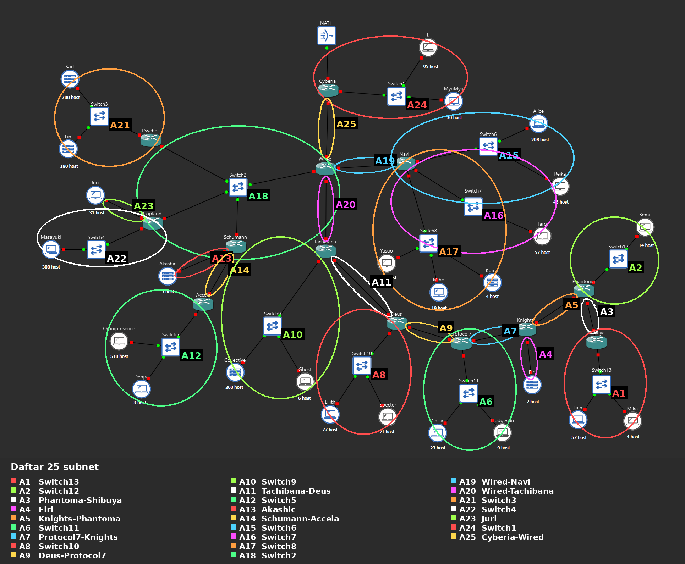

Catatan mengenai link Cyberia ke NAT1. Secara definisi link tersebut juga sebuah subnet, karena dia domain broadcast tersendiri, sehingga kalau seluruh segmen Layer 2 dihitung jumlahnya menjadi 26. Link itu sengaja tidak diberi nomor dan tidak ikut dihitung, karena interface `eth0` Cyberia yang menghadap NAT1 tidak kami alokasikan sendiri. Interface tersebut diset `dhcp` dan memperoleh alamat dari cloud NAT GNS3 pada range `192.168.122.0/24`, yang berada di luar prefix kelompok. Yang dibagi pada praktikum ini hanya subnet yang alamatnya diambil dari prefix `192.245.0.0/16`, dan jumlahnya **25**.

## Menentukan Kebutuhan IP Tiap Subnet

Sesuai ketentuan soal, jumlah IP yang dibutuhkan satu subnet adalah **jumlah host ditambah jumlah interface router yang berada di subnet itu**.

Contoh perhitungan:

- Switch8 berisi Yasuo 120, Miho 18, dan Kuma 4, ditambah 1 interface Navi, jadi 143 IP
- Switch2 tidak punya host sama sekali, tetapi ada 4 interface router, jadi 4 IP
- Setiap link antar router butuh 2 IP

Setelah jumlah IP diketahui, netmask dipilih sebagai blok terkecil yang masih muat. Perlu diingat setiap subnet kehilangan 2 alamat untuk Network ID dan Broadcast, jadi `/26` yang berisi 64 alamat hanya menampung 62 host.

Inilah isi **sheet Rute**:

| Subnet | Rute | Jumlah IP | Netmask |
|---|---|---|---|
| A1 | Shibuya > Switch13 > Lain, Mika | 62 | /26 |
| A2 | Phantoma > Switch12 > Semi | 15 | /27 |
| A3 | Phantoma > Shibuya | 2 | /30 |
| A4 | Knights > Eiri | 3 | /29 |
| A5 | Knights > Phantoma | 2 | /30 |
| A6 | Protocol7 > Switch11 > Chisa, Hodgeson | 33 | /26 |
| A7 | Protocol7 > Knights | 2 | /30 |
| A8 | Deus > Switch10 > Lilith, Specter | 99 | /25 |
| A9 | Deus > Protocol7 | 2 | /30 |
| A10 | Tachibana > Switch9 > Collective, Ghost | 267 | /23 |
| A11 | Tachibana > Deus | 2 | /30 |
| A12 | Accela > Switch5 > Omnipresence, Denpa | 514 | /22 |
| A13 | Schumann > Akashic | 4 | /29 |
| A14 | Schumann > Accela | 2 | /30 |
| A15 | Navi > Switch6 > Alice, Reika | 254 | /24 |
| A16 | Navi > Switch7 > Taro | 58 | /26 |
| A17 | Navi > Switch8 > Yasuo, Miho, Kuma | 143 | /24 |
| A18 | Wired > Switch2 > Psyche, Copland, Schumann | 4 | /29 |
| A19 | Wired > Navi | 2 | /30 |
| A20 | Wired > Tachibana | 2 | /30 |
| A21 | Psyche > Switch3 > Karl, Lin | 881 | /22 |
| A22 | Copland > Switch4 > Masayuki | 301 | /23 |
| A23 | Copland > Juri | 32 | /26 |
| A24 | Cyberia > Switch1 > JJ, MyuMyu | 126 | /25 |
| A25 | Cyberia > Wired | 2 | /30 |
| **Total** | | **2814** | **/18** |

## Penggabungan CIDR

Berbeda dengan VLSM yang langsung membagi satu blok besar sesuai kebutuhan, CIDR bekerja dari arah sebaliknya. Subnet digabungkan dari bawah ke atas sampai terbentuk satu blok besar, dan blok itulah yang menjadi akar.

**Aturannya:** netmask hasil gabungan adalah **1 tingkat di atas netmask terbesar yang digabungkan**. Ukuran blok yang lebih kecil tidak diperhitungkan sama sekali.

Contoh, A2 `/27` digabung dengan A3 `/30` menghasilkan B1 `/26`, karena yang terbesar adalah `/27` lalu naik satu tingkat.

**Arah penggabungan** dimulai dari subnet yang paling jauh dari cloud, yaitu Switch13 di Shibuya, lalu merambat ke dalam menuju Cyberia.

### Alasan urutan penggabungan

Pada router yang memiliki tiga cabang atau lebih, modul tidak menentukan cabang mana yang digabung lebih dulu. Dalam pengerjaan ini dipilih **menggabungkan dua blok terkecil lebih dulu**.

Alasannya, aturan "satu tingkat di atas yang terbesar" membuat blok besar yang digabung terlalu awal akan terus menyeret hasilnya membesar di setiap tingkat berikutnya. Dengan menggabungkan yang kecil lebih dulu, pertumbuhan netmask tertahan.

Hasilnya blok akar `192.245.0.0/18`. Sebagai perbandingan, penggabungan yang dilakukan asal urut menghasilkan `/15`, yang bahkan tidak muat di dalam prefix `/16` kelompok ini.

### Tabel penggabungan

**Tingkat I**

| Subnet | Gabungan dari | Netmask | dan | Netmask | Netmask Akhir |
|---|---|---|---|---|---|
| B1 | A2 | /27 | A3 | /30 | /26 |
| B2 | A4 | /29 | A5 | /30 | /28 |
| B3 | A6 | /26 | A7 | /30 | /25 |
| B4 | A8 | /25 | A9 | /30 | /24 |
| B5 | A10 | /23 | A11 | /30 | /22 |
| B6 | A13 | /29 | A14 | /30 | /28 |
| B7 | A15 | /24 | A16 | /26 | /23 |
| B8 | A19 | /30 | A20 | /30 | /29 |
| B9 | A22 | /23 | A23 | /26 | /22 |
| B10 | A24 | /25 | A25 | /30 | /24 |

**Tingkat II**

| Subnet | Gabungan dari | Netmask | dan | Netmask | Netmask Akhir |
|---|---|---|---|---|---|
| C1 | A1 | /26 | B1 | /26 | /25 |
| C2 | A12 | /22 | B6 | /28 | /21 |
| C3 | B7 | /23 | A17 | /24 | /22 |
| C4 | A18 | /29 | B8 | /29 | /28 |
| C5 | A21 | /22 | B9 | /22 | /21 |

**Tingkat III**

| Subnet | Gabungan dari | Netmask | dan | Netmask | Netmask Akhir |
|---|---|---|---|---|---|
| D1 | C1 | /25 | B2 | /28 | /24 |
| D2 | C3 | /22 | C4 | /28 | /21 |

**Tingkat IV**

| Subnet | Gabungan dari | Netmask | dan | Netmask | Netmask Akhir |
|---|---|---|---|---|---|
| E1 | D1 | /24 | B3 | /25 | /23 |
| E2 | D2 | /21 | C5 | /21 | /20 |

**Tingkat V**

| Subnet | Gabungan dari | Netmask | dan | Netmask | Netmask Akhir |
|---|---|---|---|---|---|
| F1 | E1 | /23 | B4 | /24 | /22 |

**Tingkat VI**

| Subnet | Gabungan dari | Netmask | dan | Netmask | Netmask Akhir |
|---|---|---|---|---|---|
| G1 | F1 | /22 | B5 | /22 | /21 |

**Tingkat VII**

| Subnet | Gabungan dari | Netmask | dan | Netmask | Netmask Akhir |
|---|---|---|---|---|---|
| H1 | G1 | /21 | C2 | /21 | /20 |

**Tingkat VIII**

| Subnet | Gabungan dari | Netmask | dan | Netmask | Netmask Akhir |
|---|---|---|---|---|---|
| I1 | H1 | /20 | E2 | /20 | /19 |

**Tingkat IX**

| Subnet | Gabungan dari | Netmask | dan | Netmask | Netmask Akhir |
|---|---|---|---|---|---|
| J1 | I1 | /19 | B10 | /24 | /18 |

Blok akhir **J1 = `192.245.0.0/18`**.

## Menurunkan Pohon dan Alokasi Alamat

Setelah akar didapat, penggabungan dibaca terbalik. Blok akar dipecah mengikuti struktur penggabungan tadi, bukan dibelah dua sama besar seperti pada VLSM.

Contoh, `192.245.0.0/18` adalah hasil gabungan `/24` milik Cyberia dan `/19` milik Wired. Jadi saat diturunkan, blok itu dipecah menjadi `/24` dan `/19`, bukan menjadi dua `/19`.

Dua aturan yang dipakai saat memberi alamat:

1. **Blok yang lebih besar mendapat alamat lebih dulu.** Ini mencegah pecahan ruang kosong yang tidak bisa dipakai
2. **Alamat awal sebuah blok harus kelipatan ukurannya.** Blok `/22` berisi 1024 alamat, jadi alamat awalnya harus kelipatan 1024

### Pohon CIDR

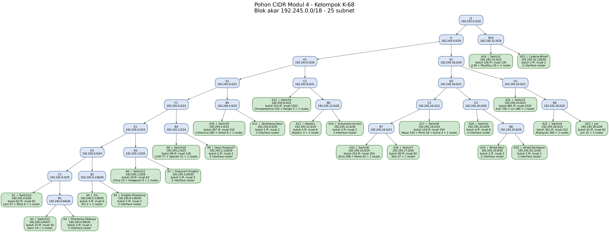

Bentuk teksnya:

```
J1 192.245.0.0/18
|-- I1 192.245.0.0/19
|   |-- H1 192.245.0.0/20
|   |   |-- G1 192.245.0.0/21
|   |   |   |-- F1 192.245.0.0/22
|   |   |   |   |-- E1 192.245.0.0/23
|   |   |   |   |   |-- D1 192.245.0.0/24
|   |   |   |   |   |   |-- C1 192.245.0.0/25
|   |   |   |   |   |   |   |-- A1 192.245.0.0/26   [Switch13]
|   |   |   |   |   |   |   `-- B1 192.245.0.64/26
|   |   |   |   |   |   |       |-- A2 192.245.0.64/27   [Switch12]
|   |   |   |   |   |   |       `-- A3 192.245.0.96/30   [Phantoma-Shibuya]
|   |   |   |   |   |   `-- B2 192.245.0.128/28
|   |   |   |   |   |       |-- A4 192.245.0.128/29   [Eiri]
|   |   |   |   |   |       `-- A5 192.245.0.136/30   [Knights-Phantoma]
|   |   |   |   |   `-- B3 192.245.1.0/25
|   |   |   |   |       |-- A6 192.245.1.0/26   [Switch11]
|   |   |   |   |       `-- A7 192.245.1.64/30   [Protocol7-Knights]
|   |   |   |   `-- B4 192.245.2.0/24
|   |   |   |       |-- A8 192.245.2.0/25   [Switch10]
|   |   |   |       `-- A9 192.245.2.128/30   [Deus-Protocol7]
|   |   |   `-- B5 192.245.4.0/22
|   |   |       |-- A10 192.245.4.0/23   [Switch9]
|   |   |       `-- A11 192.245.6.0/30   [Tachibana-Deus]
|   |   `-- C2 192.245.8.0/21
|   |       |-- A12 192.245.8.0/22   [Switch5]
|   |       `-- B6 192.245.12.0/28
|   |           |-- A13 192.245.12.0/29   [Akashic]
|   |           `-- A14 192.245.12.8/30   [Schumann-Accela]
|   `-- E2 192.245.16.0/20
|       |-- D2 192.245.16.0/21
|       |   |-- C3 192.245.16.0/22
|       |   |   |-- B7 192.245.16.0/23
|       |   |   |   |-- A15 192.245.16.0/24   [Switch6]
|       |   |   |   `-- A16 192.245.17.0/26   [Switch7]
|       |   |   `-- A17 192.245.18.0/24   [Switch8]
|       |   `-- C4 192.245.20.0/28
|       |       |-- A18 192.245.20.0/29   [Switch2]
|       |       `-- B8 192.245.20.8/29
|       |           |-- A19 192.245.20.8/30   [Wired-Navi]
|       |           `-- A20 192.245.20.12/30   [Wired-Tachibana]
|       `-- C5 192.245.24.0/21
|           |-- A21 192.245.24.0/22   [Switch3]
|           `-- B9 192.245.28.0/22
|               |-- A22 192.245.28.0/23   [Switch4]
|               `-- A23 192.245.30.0/26   [Juri]
`-- B10 192.245.32.0/24
    |-- A24 192.245.32.0/25   [Switch1]
    `-- A25 192.245.32.128/30   [Cyberia-Wired]
```

## Hasil Pembagian IP

Inilah isi **sheet Pembagian IP - CIDR**:

| Subnet | Network ID | Netmask | Broadcast | Range IP |
|---|---|---|---|---|
| A1 | 192.245.0.0/26 | 255.255.255.192 | 192.245.0.63 | 192.245.0.1 - 192.245.0.62 |
| A2 | 192.245.0.64/27 | 255.255.255.224 | 192.245.0.95 | 192.245.0.65 - 192.245.0.94 |
| A3 | 192.245.0.96/30 | 255.255.255.252 | 192.245.0.99 | 192.245.0.97 - 192.245.0.98 |
| A4 | 192.245.0.128/29 | 255.255.255.248 | 192.245.0.135 | 192.245.0.129 - 192.245.0.134 |
| A5 | 192.245.0.136/30 | 255.255.255.252 | 192.245.0.139 | 192.245.0.137 - 192.245.0.138 |
| A6 | 192.245.1.0/26 | 255.255.255.192 | 192.245.1.63 | 192.245.1.1 - 192.245.1.62 |
| A7 | 192.245.1.64/30 | 255.255.255.252 | 192.245.1.67 | 192.245.1.65 - 192.245.1.66 |
| A8 | 192.245.2.0/25 | 255.255.255.128 | 192.245.2.127 | 192.245.2.1 - 192.245.2.126 |
| A9 | 192.245.2.128/30 | 255.255.255.252 | 192.245.2.131 | 192.245.2.129 - 192.245.2.130 |
| A10 | 192.245.4.0/23 | 255.255.254.0 | 192.245.5.255 | 192.245.4.1 - 192.245.5.254 |
| A11 | 192.245.6.0/30 | 255.255.255.252 | 192.245.6.3 | 192.245.6.1 - 192.245.6.2 |
| A12 | 192.245.8.0/22 | 255.255.252.0 | 192.245.11.255 | 192.245.8.1 - 192.245.11.254 |
| A13 | 192.245.12.0/29 | 255.255.255.248 | 192.245.12.7 | 192.245.12.1 - 192.245.12.6 |
| A14 | 192.245.12.8/30 | 255.255.255.252 | 192.245.12.11 | 192.245.12.9 - 192.245.12.10 |
| A15 | 192.245.16.0/24 | 255.255.255.0 | 192.245.16.255 | 192.245.16.1 - 192.245.16.254 |
| A16 | 192.245.17.0/26 | 255.255.255.192 | 192.245.17.63 | 192.245.17.1 - 192.245.17.62 |
| A17 | 192.245.18.0/24 | 255.255.255.0 | 192.245.18.255 | 192.245.18.1 - 192.245.18.254 |
| A18 | 192.245.20.0/29 | 255.255.255.248 | 192.245.20.7 | 192.245.20.1 - 192.245.20.6 |
| A19 | 192.245.20.8/30 | 255.255.255.252 | 192.245.20.11 | 192.245.20.9 - 192.245.20.10 |
| A20 | 192.245.20.12/30 | 255.255.255.252 | 192.245.20.15 | 192.245.20.13 - 192.245.20.14 |
| A21 | 192.245.24.0/22 | 255.255.252.0 | 192.245.27.255 | 192.245.24.1 - 192.245.27.254 |
| A22 | 192.245.28.0/23 | 255.255.254.0 | 192.245.29.255 | 192.245.28.1 - 192.245.29.254 |
| A23 | 192.245.30.0/26 | 255.255.255.192 | 192.245.30.63 | 192.245.30.1 - 192.245.30.62 |
| A24 | 192.245.32.0/25 | 255.255.255.128 | 192.245.32.127 | 192.245.32.1 - 192.245.32.126 |
| A25 | 192.245.32.128/30 | 255.255.255.252 | 192.245.32.131 | 192.245.32.129 - 192.245.32.130 |

Rentang yang terpakai `192.245.0.0` sampai `192.245.32.131`, seluruhnya berada di dalam blok akar `192.245.0.0/18`, dan tidak ada satu pun subnet yang tumpang tindih.

## Membangun Topologi GNS3

| Jenis | Jumlah | Image |
|---|---|---|
| Router | 13 | `ardhptr21/debinet:latest` |
| Switch | 13 | switch bawaan GNS3 |
| Node host | 25 | `ardhptr21/alpinet:latest` |
| NAT | 1 | NAT bawaan |

Router memakai debinet karena membutuhkan `ip route` untuk static routing. Node host memakai alpinet yang lebih ringan, karena hanya perlu alamat IP dan ping.

Jumlah adapter tiap router diatur menjadi 8 lewat klik kanan node, Configure, Network, Adapters. Pengaturan dilakukan per node, bukan lewat Preferences, karena controller dipakai bersama seluruh kelompok.

Kabel ditarik berurutan dari Cyberia ke bawah, sehingga nomor interface tiap router mengikuti pola yang konsisten: **eth0 selalu menghadap ke atas, ke arah internet**.

| Router | eth0 | eth1 | eth2 | eth3 |
|---|---|---|---|---|
| Cyberia | NAT1 | Switch1 | Wired |  |
| Wired | Cyberia | Switch2 | Navi | Tachibana |
| Psyche | Switch2 | Switch3 |  |  |
| Copland | Switch2 | Switch4 | Juri |  |
| Schumann | Switch2 | Akashic | Accela |  |
| Accela | Schumann | Switch5 |  |  |
| Navi | Wired | Switch6 | Switch7 | Switch8 |
| Tachibana | Wired | Switch9 | Deus |  |
| Deus | Tachibana | Switch10 | Protocol7 |  |
| Protocol7 | Deus | Switch11 | Knights |  |
| Knights | Protocol7 | Eiri | Phantoma |  |
| Phantoma | Knights | Switch12 | Shibuya |  |
| Shibuya | Phantoma | Switch13 |  |  |

Topologi lengkap beserta jumlah host tiap node:

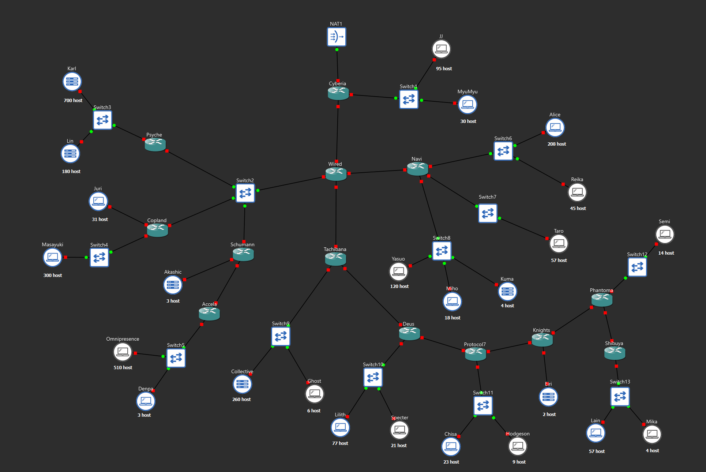

Antar router disambung langsung tanpa switch, sesuai gambar soal. Switch2 menerima empat kabel sekaligus, dari Wired, Psyche, Copland, dan Schumann.

Nomor interface tiap sambungan:

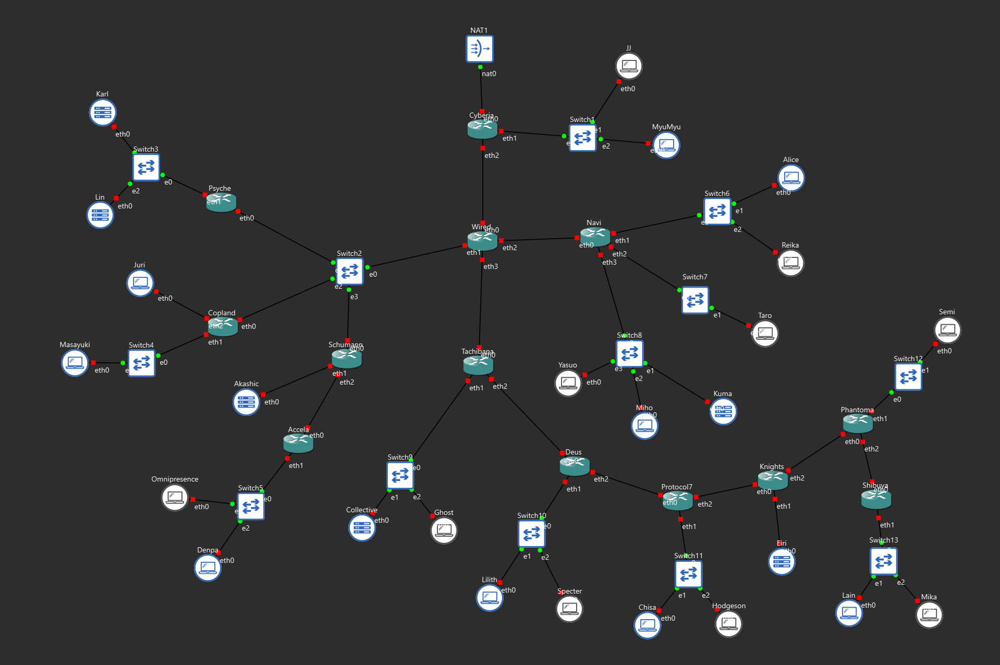

Seluruh 52 node berjalan:

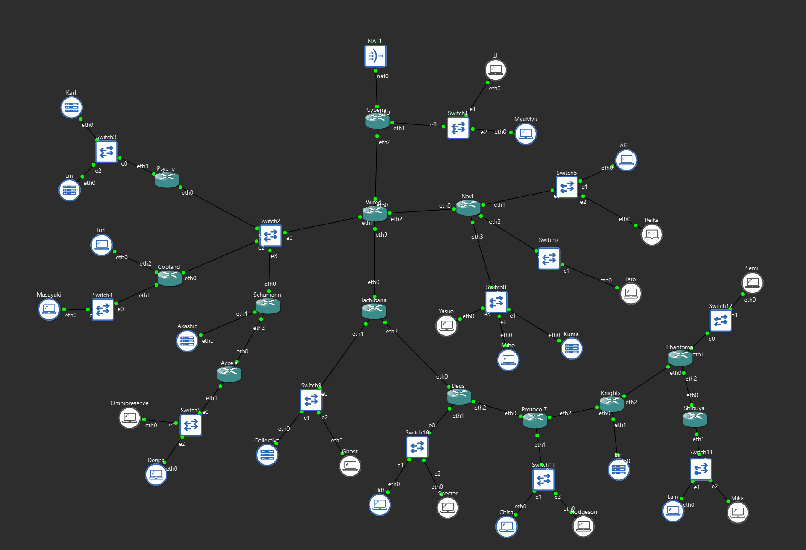

## Konfigurasi Router

Setiap router dikonfigurasi dengan dua berkas:

1. **`/etc/network/interfaces`**, disunting lewat Configure, Edit network configuration, dengan node dalam keadaan mati
2. **`/root/route.sh`**, dibuat lewat console node yang sudah menyala

Perintah routing sengaja dipisah ke berkas `.sh` di `/root`, bukan ditulis langsung di interfaces, karena editor GNS3 membuang baris yang memuat karakter `>`. Berkas interfaces hanya memanggilnya lewat baris `up bash /root/route.sh`, yang ditaruh di interface terakhir supaya saat script berjalan semua interface sudah hidup.

Lokasi `/root` dipilih karena hanya `/root` dan `/etc/network/interfaces` yang bertahan saat node Docker direstart.

### Cyberia

`/etc/network/interfaces`

```
# eth0 -> NAT1
auto eth0
iface eth0 inet dhcp

# eth1 -> Switch1
auto eth1
iface eth1 inet static
	address 192.245.32.1
	netmask 255.255.255.128

# eth2 -> Wired
auto eth2
iface eth2 inet static
	address 192.245.32.129
	netmask 255.255.255.252
	up bash /root/route.sh

```

`/root/route.sh`

```bash
cat > /root/route.sh <<'EOF'
#!/bin/bash
sysctl -w net.ipv4.ip_forward=1
iptables -t nat -C POSTROUTING -o eth0 -j MASQUERADE 2>/dev/null || \
    iptables -t nat -A POSTROUTING -o eth0 -j MASQUERADE
ip route add 192.245.0.0/19 via 192.245.32.130
EOF
chmod +x /root/route.sh
bash /root/route.sh
```

### Wired

`/etc/network/interfaces`

```
# eth0 -> Cyberia
auto eth0
iface eth0 inet static
	address 192.245.32.130
	netmask 255.255.255.252

# eth1 -> Switch2
auto eth1
iface eth1 inet static
	address 192.245.20.1
	netmask 255.255.255.248

# eth2 -> Navi
auto eth2
iface eth2 inet static
	address 192.245.20.9
	netmask 255.255.255.252

# eth3 -> Tachibana
auto eth3
iface eth3 inet static
	address 192.245.20.13
	netmask 255.255.255.252
	up bash /root/route.sh

```

`/root/route.sh`

```bash
cat > /root/route.sh <<'EOF'
#!/bin/bash
ip route add 192.245.16.0/22 via 192.245.20.10
ip route add 192.245.0.0/21 via 192.245.20.14
ip route add 192.245.24.0/22 via 192.245.20.2
ip route add 192.245.28.0/22 via 192.245.20.3
ip route add 192.245.8.0/21 via 192.245.20.4
ip route add default via 192.245.32.129
EOF
chmod +x /root/route.sh
bash /root/route.sh
```

### Psyche

`/etc/network/interfaces`

```
# eth0 -> Switch2
auto eth0
iface eth0 inet static
	address 192.245.20.2
	netmask 255.255.255.248

# eth1 -> Switch3
auto eth1
iface eth1 inet static
	address 192.245.24.1
	netmask 255.255.252.0
	up bash /root/route.sh

```

`/root/route.sh`

```bash
cat > /root/route.sh <<'EOF'
#!/bin/bash
ip route add default via 192.245.20.1
EOF
chmod +x /root/route.sh
bash /root/route.sh
```

### Copland

`/etc/network/interfaces`

```
# eth0 -> Switch2
auto eth0
iface eth0 inet static
	address 192.245.20.3
	netmask 255.255.255.248

# eth1 -> Switch4
auto eth1
iface eth1 inet static
	address 192.245.28.1
	netmask 255.255.254.0

# eth2 -> Juri
auto eth2
iface eth2 inet static
	address 192.245.30.1
	netmask 255.255.255.192
	up bash /root/route.sh

```

`/root/route.sh`

```bash
cat > /root/route.sh <<'EOF'
#!/bin/bash
ip route add default via 192.245.20.1
EOF
chmod +x /root/route.sh
bash /root/route.sh
```

### Schumann

`/etc/network/interfaces`

```
# eth0 -> Switch2
auto eth0
iface eth0 inet static
	address 192.245.20.4
	netmask 255.255.255.248

# eth1 -> Akashic
auto eth1
iface eth1 inet static
	address 192.245.12.1
	netmask 255.255.255.248

# eth2 -> Accela
auto eth2
iface eth2 inet static
	address 192.245.12.9
	netmask 255.255.255.252
	up bash /root/route.sh

```

`/root/route.sh`

```bash
cat > /root/route.sh <<'EOF'
#!/bin/bash
ip route add 192.245.8.0/22 via 192.245.12.10
ip route add default via 192.245.20.1
EOF
chmod +x /root/route.sh
bash /root/route.sh
```

### Accela

`/etc/network/interfaces`

```
# eth0 -> Schumann
auto eth0
iface eth0 inet static
	address 192.245.12.10
	netmask 255.255.255.252

# eth1 -> Switch5
auto eth1
iface eth1 inet static
	address 192.245.8.1
	netmask 255.255.252.0
	up bash /root/route.sh

```

`/root/route.sh`

```bash
cat > /root/route.sh <<'EOF'
#!/bin/bash
ip route add default via 192.245.12.9
EOF
chmod +x /root/route.sh
bash /root/route.sh
```

### Navi

`/etc/network/interfaces`

```
# eth0 -> Wired
auto eth0
iface eth0 inet static
	address 192.245.20.10
	netmask 255.255.255.252

# eth1 -> Switch6
auto eth1
iface eth1 inet static
	address 192.245.16.1
	netmask 255.255.255.0

# eth2 -> Switch7
auto eth2
iface eth2 inet static
	address 192.245.17.1
	netmask 255.255.255.192

# eth3 -> Switch8
auto eth3
iface eth3 inet static
	address 192.245.18.1
	netmask 255.255.255.0
	up bash /root/route.sh

```

`/root/route.sh`

```bash
cat > /root/route.sh <<'EOF'
#!/bin/bash
ip route add default via 192.245.20.9
EOF
chmod +x /root/route.sh
bash /root/route.sh
```

### Tachibana

`/etc/network/interfaces`

```
# eth0 -> Wired
auto eth0
iface eth0 inet static
	address 192.245.20.14
	netmask 255.255.255.252

# eth1 -> Switch9
auto eth1
iface eth1 inet static
	address 192.245.4.1
	netmask 255.255.254.0

# eth2 -> Deus
auto eth2
iface eth2 inet static
	address 192.245.6.1
	netmask 255.255.255.252
	up bash /root/route.sh

```

`/root/route.sh`

```bash
cat > /root/route.sh <<'EOF'
#!/bin/bash
ip route add 192.245.0.0/22 via 192.245.6.2
ip route add default via 192.245.20.13
EOF
chmod +x /root/route.sh
bash /root/route.sh
```

### Deus

`/etc/network/interfaces`

```
# eth0 -> Tachibana
auto eth0
iface eth0 inet static
	address 192.245.6.2
	netmask 255.255.255.252

# eth1 -> Switch10
auto eth1
iface eth1 inet static
	address 192.245.2.1
	netmask 255.255.255.128

# eth2 -> Protocol7
auto eth2
iface eth2 inet static
	address 192.245.2.129
	netmask 255.255.255.252
	up bash /root/route.sh

```

`/root/route.sh`

```bash
cat > /root/route.sh <<'EOF'
#!/bin/bash
ip route add 192.245.0.0/23 via 192.245.2.130
ip route add default via 192.245.6.1
EOF
chmod +x /root/route.sh
bash /root/route.sh
```

### Protocol7

`/etc/network/interfaces`

```
# eth0 -> Deus
auto eth0
iface eth0 inet static
	address 192.245.2.130
	netmask 255.255.255.252

# eth1 -> Switch11
auto eth1
iface eth1 inet static
	address 192.245.1.1
	netmask 255.255.255.192

# eth2 -> Knights
auto eth2
iface eth2 inet static
	address 192.245.1.65
	netmask 255.255.255.252
	up bash /root/route.sh

```

`/root/route.sh`

```bash
cat > /root/route.sh <<'EOF'
#!/bin/bash
ip route add 192.245.0.0/24 via 192.245.1.66
ip route add default via 192.245.2.129
EOF
chmod +x /root/route.sh
bash /root/route.sh
```

### Knights

`/etc/network/interfaces`

```
# eth0 -> Protocol7
auto eth0
iface eth0 inet static
	address 192.245.1.66
	netmask 255.255.255.252

# eth1 -> Eiri
auto eth1
iface eth1 inet static
	address 192.245.0.129
	netmask 255.255.255.248

# eth2 -> Phantoma
auto eth2
iface eth2 inet static
	address 192.245.0.137
	netmask 255.255.255.252
	up bash /root/route.sh

```

`/root/route.sh`

```bash
cat > /root/route.sh <<'EOF'
#!/bin/bash
ip route add 192.245.0.0/25 via 192.245.0.138
ip route add default via 192.245.1.65
EOF
chmod +x /root/route.sh
bash /root/route.sh
```

### Phantoma

`/etc/network/interfaces`

```
# eth0 -> Knights
auto eth0
iface eth0 inet static
	address 192.245.0.138
	netmask 255.255.255.252

# eth1 -> Switch12
auto eth1
iface eth1 inet static
	address 192.245.0.65
	netmask 255.255.255.224

# eth2 -> Shibuya
auto eth2
iface eth2 inet static
	address 192.245.0.97
	netmask 255.255.255.252
	up bash /root/route.sh

```

`/root/route.sh`

```bash
cat > /root/route.sh <<'EOF'
#!/bin/bash
ip route add 192.245.0.0/26 via 192.245.0.98
ip route add default via 192.245.0.137
EOF
chmod +x /root/route.sh
bash /root/route.sh
```

### Shibuya

`/etc/network/interfaces`

```
# eth0 -> Phantoma
auto eth0
iface eth0 inet static
	address 192.245.0.98
	netmask 255.255.255.252

# eth1 -> Switch13
auto eth1
iface eth1 inet static
	address 192.245.0.1
	netmask 255.255.255.192
	up bash /root/route.sh

```

`/root/route.sh`

```bash
cat > /root/route.sh <<'EOF'
#!/bin/bash
ip route add default via 192.245.0.97
EOF
chmod +x /root/route.sh
bash /root/route.sh
```

### Catatan tentang routing

Perintah `ip route add` menuju router yang belum dikonfigurasi pasti gagal saat pertama dijalankan, karena alamat tujuannya belum ada. Karena itu setelah seluruh router dan node host selesai, `bash /root/route.sh` dijalankan ulang satu kali di setiap router.

Setiap router hanya memerlukan satu rute per cabang, yaitu blok gabungan cabang tersebut, ditambah satu default route ke arah atas. Inilah keuntungan utama CIDR dibandingkan VLSM.

## Konfigurasi Node Host

Setiap node host memakai satu interface `eth0`, dengan gateway berupa alamat pertama di subnetnya, yaitu alamat router.

**Switch1**, subnet A24 `192.245.32.0/25`, gateway `192.245.32.1` milik Cyberia

JJ
```
auto eth0
iface eth0 inet static
	address 192.245.32.2
	netmask 255.255.255.128
	gateway 192.245.32.1
```
MyuMyu
```
auto eth0
iface eth0 inet static
	address 192.245.32.3
	netmask 255.255.255.128
	gateway 192.245.32.1
```

**Switch3**, subnet A21 `192.245.24.0/22`, gateway `192.245.24.1` milik Psyche

Karl
```
auto eth0
iface eth0 inet static
	address 192.245.24.2
	netmask 255.255.252.0
	gateway 192.245.24.1
```
Lin
```
auto eth0
iface eth0 inet static
	address 192.245.24.3
	netmask 255.255.252.0
	gateway 192.245.24.1
```

**Switch4**, subnet A22 `192.245.28.0/23`, gateway `192.245.28.1` milik Copland

Masayuki
```
auto eth0
iface eth0 inet static
	address 192.245.28.2
	netmask 255.255.254.0
	gateway 192.245.28.1
```

**Juri**, subnet A23 `192.245.30.0/26`, gateway `192.245.30.1` milik Copland

Juri
```
auto eth0
iface eth0 inet static
	address 192.245.30.2
	netmask 255.255.255.192
	gateway 192.245.30.1
```

**Akashic**, subnet A13 `192.245.12.0/29`, gateway `192.245.12.1` milik Schumann

Akashic
```
auto eth0
iface eth0 inet static
	address 192.245.12.2
	netmask 255.255.255.248
	gateway 192.245.12.1
```

**Switch5**, subnet A12 `192.245.8.0/22`, gateway `192.245.8.1` milik Accela

Omnipresence
```
auto eth0
iface eth0 inet static
	address 192.245.8.2
	netmask 255.255.252.0
	gateway 192.245.8.1
```
Denpa
```
auto eth0
iface eth0 inet static
	address 192.245.8.3
	netmask 255.255.252.0
	gateway 192.245.8.1
```

**Switch6**, subnet A15 `192.245.16.0/24`, gateway `192.245.16.1` milik Navi

Alice
```
auto eth0
iface eth0 inet static
	address 192.245.16.2
	netmask 255.255.255.0
	gateway 192.245.16.1
```
Reika
```
auto eth0
iface eth0 inet static
	address 192.245.16.3
	netmask 255.255.255.0
	gateway 192.245.16.1
```

**Switch7**, subnet A16 `192.245.17.0/26`, gateway `192.245.17.1` milik Navi

Taro
```
auto eth0
iface eth0 inet static
	address 192.245.17.2
	netmask 255.255.255.192
	gateway 192.245.17.1
```

**Switch8**, subnet A17 `192.245.18.0/24`, gateway `192.245.18.1` milik Navi

Yasuo
```
auto eth0
iface eth0 inet static
	address 192.245.18.2
	netmask 255.255.255.0
	gateway 192.245.18.1
```
Miho
```
auto eth0
iface eth0 inet static
	address 192.245.18.3
	netmask 255.255.255.0
	gateway 192.245.18.1
```
Kuma
```
auto eth0
iface eth0 inet static
	address 192.245.18.4
	netmask 255.255.255.0
	gateway 192.245.18.1
```

**Switch9**, subnet A10 `192.245.4.0/23`, gateway `192.245.4.1` milik Tachibana

Collective
```
auto eth0
iface eth0 inet static
	address 192.245.4.2
	netmask 255.255.254.0
	gateway 192.245.4.1
```
Ghost
```
auto eth0
iface eth0 inet static
	address 192.245.4.3
	netmask 255.255.254.0
	gateway 192.245.4.1
```

**Switch10**, subnet A8 `192.245.2.0/25`, gateway `192.245.2.1` milik Deus

Lilith
```
auto eth0
iface eth0 inet static
	address 192.245.2.2
	netmask 255.255.255.128
	gateway 192.245.2.1
```
Specter
```
auto eth0
iface eth0 inet static
	address 192.245.2.3
	netmask 255.255.255.128
	gateway 192.245.2.1
```

**Switch11**, subnet A6 `192.245.1.0/26`, gateway `192.245.1.1` milik Protocol7

Chisa
```
auto eth0
iface eth0 inet static
	address 192.245.1.2
	netmask 255.255.255.192
	gateway 192.245.1.1
```
Hodgeson
```
auto eth0
iface eth0 inet static
	address 192.245.1.3
	netmask 255.255.255.192
	gateway 192.245.1.1
```

**Eiri**, subnet A4 `192.245.0.128/29`, gateway `192.245.0.129` milik Knights

Eiri
```
auto eth0
iface eth0 inet static
	address 192.245.0.130
	netmask 255.255.255.248
	gateway 192.245.0.129
```

**Switch12**, subnet A2 `192.245.0.64/27`, gateway `192.245.0.65` milik Phantoma

Semi
```
auto eth0
iface eth0 inet static
	address 192.245.0.66
	netmask 255.255.255.224
	gateway 192.245.0.65
```

**Switch13**, subnet A1 `192.245.0.0/26`, gateway `192.245.0.1` milik Shibuya

Lain
```
auto eth0
iface eth0 inet static
	address 192.245.0.2
	netmask 255.255.255.192
	gateway 192.245.0.1
```
Mika
```
auto eth0
iface eth0 inet static
	address 192.245.0.3
	netmask 255.255.255.192
	gateway 192.245.0.1
```

## Pengujian

### Uji dari node terdalam

Mika berada di Shibuya, sembilan router dari Cyberia. Kalau ping dari Mika tembus ke cabang lain, berarti hampir seluruh jalur sudah benar.

```bash
ping -c 3 192.245.24.2      # Karl, di Psyche
ping -c 3 192.245.8.2       # Omnipresence, di Accela
ping -c 3 192.245.32.2      # JJ, di Cyberia
ping -c 3 8.8.8.8
```

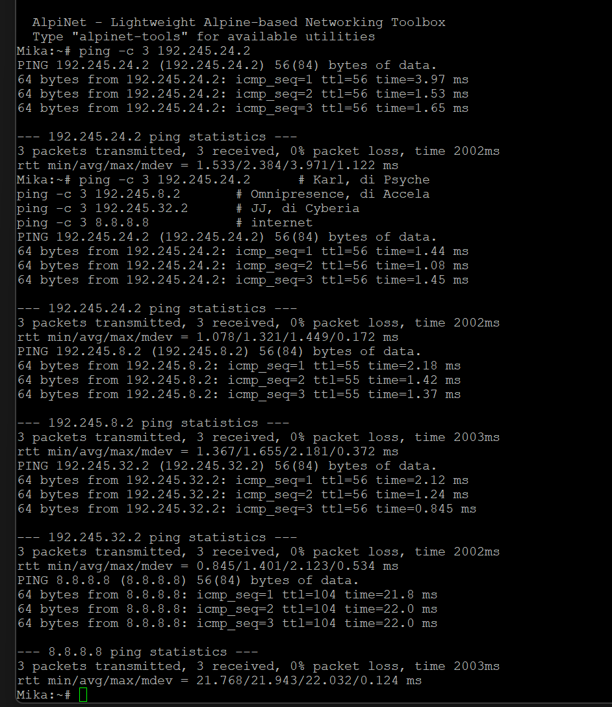

### Uji arah sebaliknya

```bash
# di Karl, Psyche
ping -c 3 192.245.0.2       # Lain, di Shibuya
ping -c 3 192.245.18.2      # Yasuo, di Navi
```

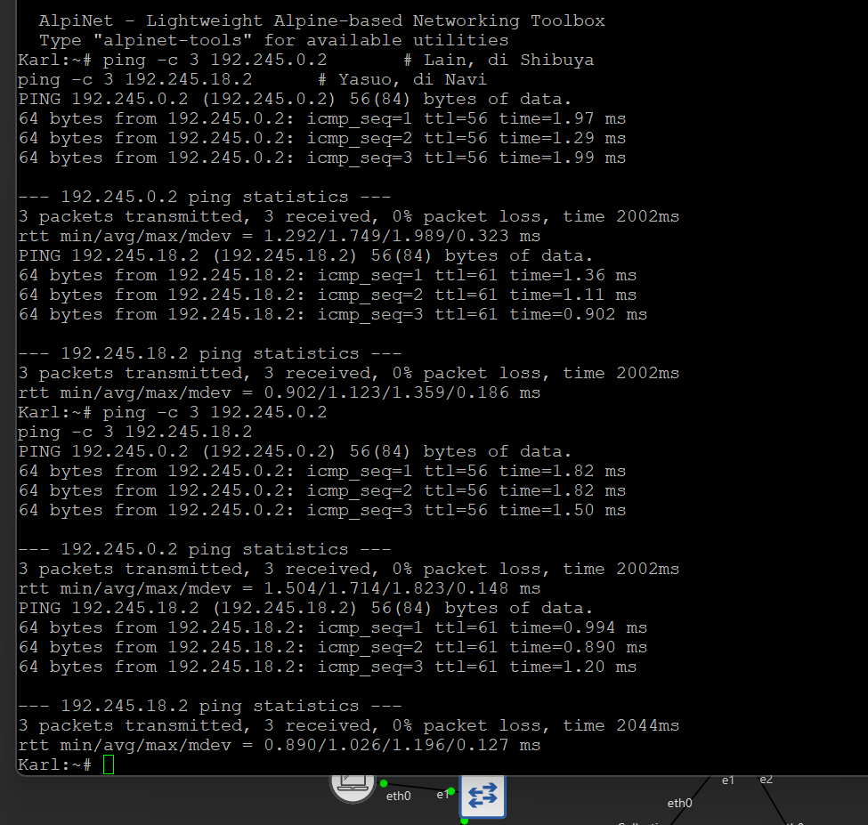

### Uji dari cabang tengah

```bash
# di Taro, Navi
ping -c 3 192.245.0.3       # Mika, di Shibuya
ping -c 3 8.8.8.8
```

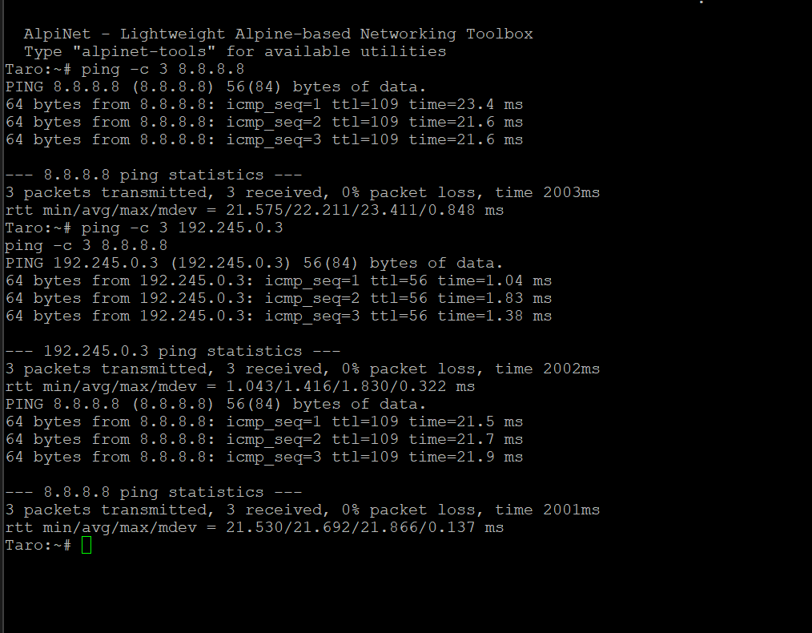

### Hasil

| Dari | Ke | TTL | Packet loss |
|---|---|---|---|
| Mika, Shibuya | Karl 192.245.24.2, Psyche | 56 | 0% |
| Mika, Shibuya | Omnipresence 192.245.8.2, Accela | 55 | 0% |
| Mika, Shibuya | JJ 192.245.32.2, Cyberia | 56 | 0% |
| Mika, Shibuya | 8.8.8.8 | 104 | 0% |
| Karl, Psyche | Lain 192.245.0.2, Shibuya | 56 | 0% |
| Karl, Psyche | Yasuo 192.245.18.2, Navi | 61 | 0% |
| Taro, Navi | Mika 192.245.0.3, Shibuya | 56 | 0% |
| Taro, Navi | 8.8.8.8 | 109 | 0% |

### Bukti routing efisien

```bash
ip route
```

**Cyberia** hanya memiliki satu rute statis untuk menjangkau 23 subnet sekaligus.

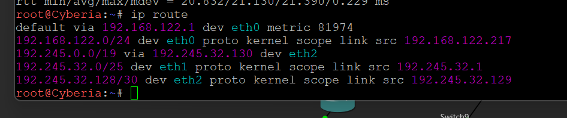

**Wired** memiliki lima rute, satu untuk setiap cabang.

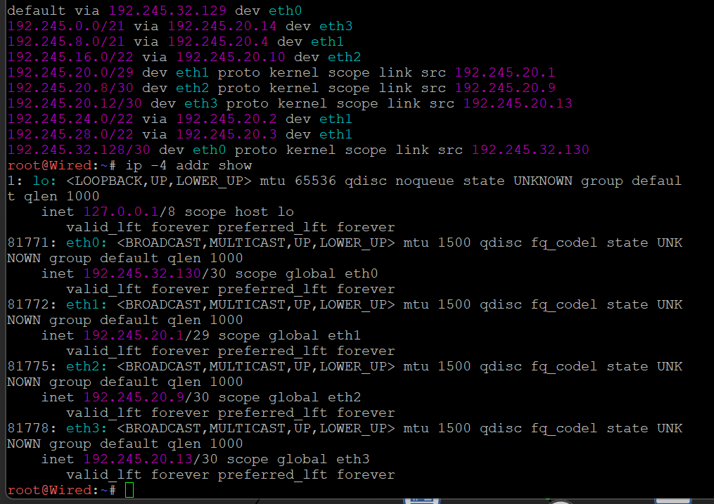

**Phantoma** hanya memiliki satu rute statis ditambah default route.

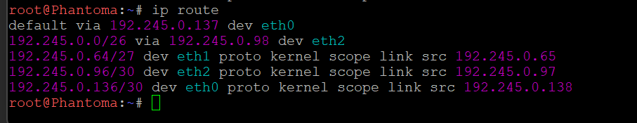

## Kesimpulan

Seluruh topologi memakai blok `192.245.0.0/18` yang dibagi menjadi 25 subnet tanpa tumpang tindih. Semua node dapat saling terhubung, dibuktikan dengan ping dari node terdalam ke cabang terjauh dengan 0% packet loss.

# Metode VLSM 

Bagian ini menjelaskan pengerjaan topologi *The Wired Expansion* menggunakan **Cisco Packet Tracer (CPT)** dengan metode pembagian IP **VLSM (Variable Length Subnet Mask)**.

| Parameter | Keterangan |
|---|---|
| Blok Akar (Root Block) | `192.245.0.0/18` |
| Prefix IP | `192.245` |
| Metode Pembagian | VLSM (dibagi dari kebutuhan host terbesar ke terkecil) |

## 1. Perhitungan Kebutuhan IP dan Pembagian VLSM

Sesuai ketentuan soal, jumlah IP yang dibutuhkan satu subnet adalah **jumlah host ditambah jumlah interface router** pada subnet tersebut. Terdapat 25 subnet yang dibagi berdasarkan urutan kebutuhan IP terbesar ke terkecil agar tidak ada alamat yang terbuang (efisien).

Berikut adalah tabel pembagian alamat IP menggunakan VLSM:

| Subnet | Rute / Segmen | Kebutuhan IP | Prefix | Network ID | Subnet Mask | Gateway Router |
|---|---|---|---|---|---|---|
| A21 | Psyche > Switch3 | 881 | /22 | `192.245.0.0` | 255.255.252.0 | `192.245.0.1` |
| A12 | Accela > Switch5 | 514 | /22 | `192.245.4.0` | 255.255.252.0 | `192.245.4.1` |
| A22 | Copland > Switch4 | 301 | /23 | `192.245.8.0` | 255.255.254.0 | `192.245.8.1` |
| A10 | Tachibana > Switch9 | 267 | /23 | `192.245.10.0` | 255.255.254.0 | `192.245.10.1` |
| A15 | Navi > Switch6 | 254 | /24 | `192.245.12.0` | 255.255.255.0 | `192.245.12.1` |
| A17 | Navi > Switch8 | 143 | /24 | `192.245.13.0` | 255.255.255.0 | `192.245.13.1` |
| A24 | Cyberia > Switch1 | 126 | /25 | `192.245.14.0` | 255.255.255.128 | `192.245.14.1` |
| A8 | Deus > Switch10 | 99 | /25 | `192.245.14.128` | 255.255.255.128 | `192.245.14.129` |
| A1 | Shibuya > Switch13 | 62 | /26 | `192.245.15.0` | 255.255.255.192 | `192.245.15.1` |
| A16 | Navi > Switch7 | 58 | /26 | `192.245.15.64` | 255.255.255.192 | `192.245.15.65` |
| A6 | Protocol7 > Switch11 | 33 | /26 | `192.245.15.128` | 255.255.255.192 | `192.245.15.129` |
| A23 | Copland > Juri | 32 | /26 | `192.245.15.192` | 255.255.255.192 | `192.245.15.193` |
| A2 | Phantoma > Switch12 | 15 | /27 | `192.245.16.0` | 255.255.255.224 | `192.245.16.1` |
| A13 | Schumann > Akashic | 4 | /29 | `192.245.16.32` | 255.255.255.248 | `192.245.16.33` |
| A18 | Wired > Switch2 | 4 | /29 | `192.245.16.40` | 255.255.255.248 | `192.245.16.41` |
| A4 | Knights > Eiri | 3 | /29 | `192.245.16.48` | 255.255.255.248 | `192.245.16.49` |
| A3 | Phantoma > Shibuya | 2 | /30 | `192.245.16.56` | 255.255.255.252 | `192.245.16.57` |
| A5 | Knights > Phantoma | 2 | /30 | `192.245.16.60` | 255.255.255.252 | `192.245.16.61` |
| A7 | Protocol7 > Knights | 2 | /30 | `192.245.16.64` | 255.255.255.252 | `192.245.16.65` |
| A9 | Deus > Protocol7 | 2 | /30 | `192.245.16.68` | 255.255.255.252 | `192.245.16.69` |
| A11 | Tachibana > Deus | 2 | /30 | `192.245.16.72` | 255.255.255.252 | `192.245.16.73` |
| A14 | Schumann > Accela | 2 | /30 | `192.245.16.76` | 255.255.255.252 | `192.245.16.77` |
| A19 | Wired > Navi | 2 | /30 | `192.245.16.80` | 255.255.255.252 | `192.245.16.81` |
| A20 | Wired > Tachibana | 2 | /30 | `192.245.16.84` | 255.255.255.252 | `192.245.16.85` |
| A25 | Cyberia > Wired | 2 | /30 | `192.245.16.88` | 255.255.255.252 | `192.245.16.89` |

## 2. Membangun Topologi CPT
* **Router**: Menggunakan seri `2811`. Karena keterbatasan port bawaan, beberapa router ditambahkan modul `NM-1FE-TX` atau `NM-2FE2W` untuk menambah interface (contoh: Cyberia, Wired, Deus).
* **Switch**: Menggunakan `2960-24TT`.
* **Kabel**: 
  * `Copper Straight-Through` untuk PC/Laptop/Server ke Switch, Switch ke Router, dan Router ke Cloud.
  * `Copper Cross-Over` untuk menghubungkan Router ke Router.

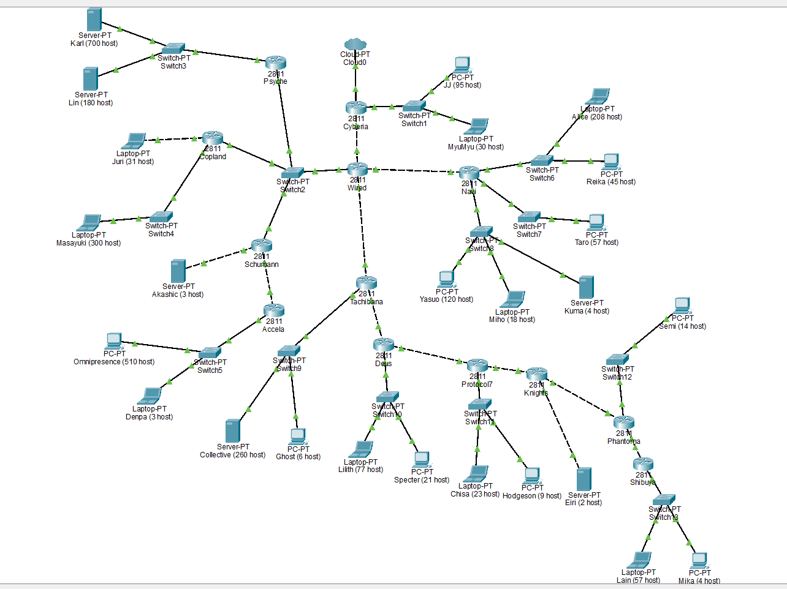

## 3. Konfigurasi End Devices
Berikut adalah daftar pengalamatan IP untuk seluruh node host yang dikonfigurasi melalui tab *Desktop > IP Configuration*:

| Nama Perangkat | IP Address | Subnet Mask | Default Gateway |
|---|---|---|---|
| Karl | `192.245.0.2` | 255.255.252.0 | `192.245.0.1` |
| Lin | `192.245.0.3` | 255.255.252.0 | `192.245.0.1` |
| Omnipresence | `192.245.4.2` | 255.255.252.0 | `192.245.4.1` |
| Denpa | `192.245.4.3` | 255.255.252.0 | `192.245.4.1` |
| Masayuki | `192.245.8.2` | 255.255.254.0 | `192.245.8.1` |
| Juri | `192.245.15.194` | 255.255.255.192 | `192.245.15.193` |
| Collective | `192.245.10.2` | 255.255.254.0 | `192.245.10.1` |
| Ghost | `192.245.10.3` | 255.255.254.0 | `192.245.10.1` |
| Alice | `192.245.12.2` | 255.255.255.0 | `192.245.12.1` |
| Reika | `192.245.12.3` | 255.255.255.0 | `192.245.12.1` |
| Yasuo | `192.245.13.2` | 255.255.255.0 | `192.245.13.1` |
| Miho | `192.245.13.3` | 255.255.255.0 | `192.245.13.1` |
| Kuma | `192.245.13.4` | 255.255.255.0 | `192.245.13.1` |
| JJ | `192.245.14.2` | 255.255.255.128 | `192.245.14.1` |
| MyuMyu | `192.245.14.3` | 255.255.255.128 | `192.245.14.1` |
| Lillith | `192.245.14.130` | 255.255.255.128 | `192.245.14.129` |
| Spector | `192.245.14.131` | 255.255.255.128 | `192.245.14.129` |
| Taro | `192.245.15.66` | 255.255.255.192 | `192.245.15.65` |
| Chisa | `192.245.15.130` | 255.255.255.192 | `192.245.15.129` |
| Hodgson | `192.245.15.131` | 255.255.255.192 | `192.245.15.129` |
| Serni | `192.245.16.2` | 255.255.255.224 | `192.245.16.1` |
| Akashic | `192.245.16.34` | 255.255.255.248 | `192.245.16.33` |
| Erin | `192.245.16.50` | 255.255.255.248 | `192.245.16.49` |
| Lain | `192.245.15.2` | 255.255.255.192 | `192.245.15.1` |
| Mika | `192.245.15.3` | 255.255.255.192 | `192.245.15.1` |

## 4. Routing (Static & Default Route)
Karena topologi berbentuk *tree* (pohon), digunakan metode **Default Route** untuk router ujung (leaf/cabang), dan **Static Route** di router pusat (Wired) serta Cyberia untuk mengenali jaringan di bawahnya.

### A. Router Ujung (Psyche, Accela, Shibuya, dll)
Cukup menggunakan satu default route mengarah ke router induk (parent).
```cisco
! Psyche
ip route 0.0.0.0 0.0.0.0 192.245.16.41
! Accela
ip route 0.0.0.0 0.0.0.0 192.245.16.77
! Shibuya
ip route 0.0.0.0 0.0.0.0 192.245.16.57
```

### B. Router Wired
Wired mendaftarkan rute spesifik untuk setiap LAN dan Link P2P di bawahnya agar bisa meneruskan paket dari/ke Cyberia.
```cisco
! Rute ke Cabang Kiri (via Psyche/Schumann)
ip route 192.245.0.0 255.255.252.0 192.245.16.42
ip route 192.245.8.0 255.255.254.0 192.245.16.43
ip route 192.245.15.192 255.255.255.192 192.245.16.43
ip route 192.245.16.32 255.255.255.248 192.245.16.44
ip route 192.245.4.0 255.255.252.0 192.245.16.44

! Rute ke Cabang Kanan (via Navi)
ip route 192.245.12.0 255.255.255.0 192.245.16.82
ip route 192.245.13.0 255.255.255.0 192.245.16.82
ip route 192.245.15.64 255.255.255.192 192.245.16.82
ip route 192.245.16.80 255.255.255.252 192.245.16.82

! Rute ke Cabang Bawah (via Tachibana)
ip route 192.245.10.0 255.255.254.0 192.245.16.86
ip route 192.245.14.128 255.255.255.128 192.245.16.86
ip route 192.245.15.0 255.255.255.192 192.245.16.86
ip route 192.245.15.128 255.255.255.192 192.245.16.86
ip route 192.245.16.0 255.255.255.224 192.245.16.86
ip route 192.245.16.48 255.255.255.248 192.245.16.86
ip route 192.245.16.56 255.255.255.252 192.245.16.86
ip route 192.245.16.60 255.255.255.252 192.245.16.86
ip route 192.245.16.64 255.255.255.252 192.245.16.86
ip route 192.245.16.68 255.255.255.252 192.245.16.86
ip route 192.245.16.72 255.255.255.252 192.245.16.86

! Default Route ke Cyberia
ip route 0.0.0.0 0.0.0.0 192.245.16.89
```

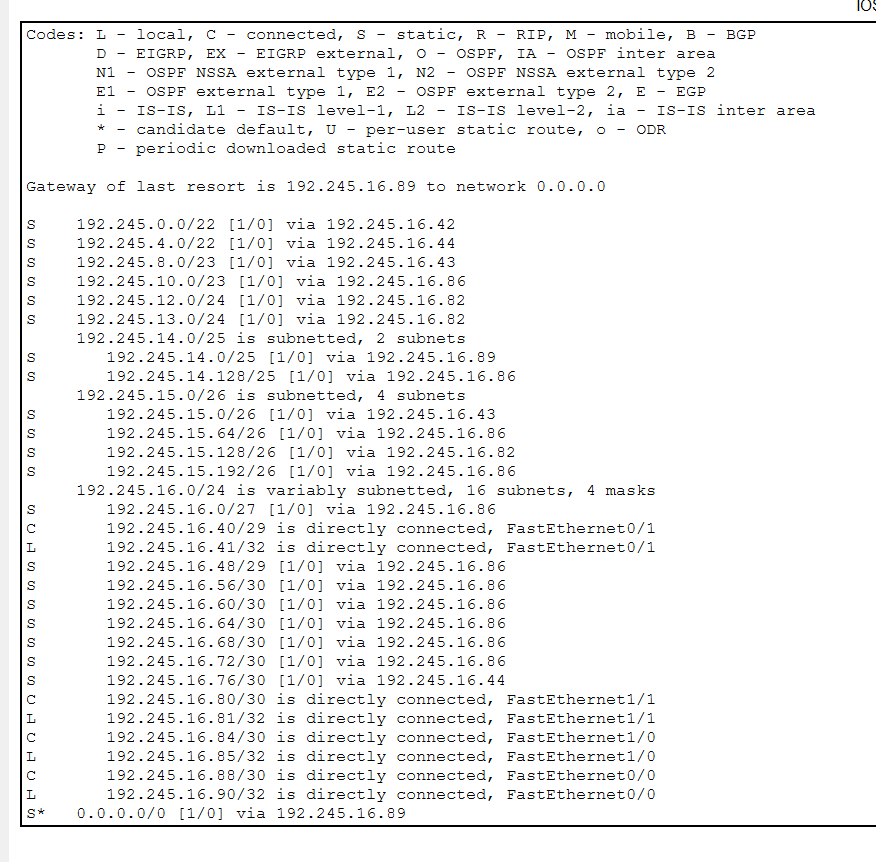

### C. Router Cyberia
Menggunakan *Summary Route* untuk menjangkau seluruh jaringan di bawah Wired.
```cisco
ip route 192.245.0.0 255.255.0.0 192.245.16.90
ip route 0.0.0.0 0.0.0.0 192.168.100.1
```

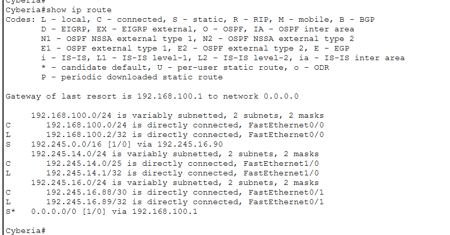

## 5. Konfigurasi NAT Overload
Dikonfigurasi pada Router Cyberia sebagai satu-satunya gerbang menuju Cloud.
```cisco
interface FastEthernet0/0
 ip nat outside
 exit
interface FastEthernet0/1
 ip nat inside
 exit
interface FastEthernet1/0
 ip nat inside
 exit

access-list 1 permit 192.245.0.0 0.0.255.255
ip nat inside source list 1 interface FastEthernet0/0 overload
```

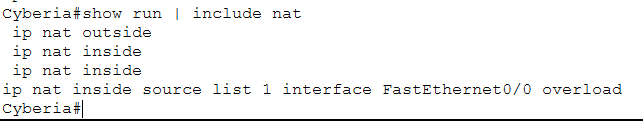

## 6. Pengujian
Pengujian dilakukan dengan melakukan *Ping* dari ujung ke ujung (End-to-End) untuk membuktikan routing berjalan dua arah:
1. **Laptop Lain (Shibuya) ke PC Karl (Psyche)**: `ping 192.245.0.2` -> **Reply**.
2. **Laptop Alice (Navi) ke Laptop MyuMyu (Cyberia)**: `ping 192.245.14.3` -> **Reply**.
3. **PC Omnipresence (Accela) ke Laptop Taro (Navi)**: `ping 192.245.15.66` -> **Reply**.

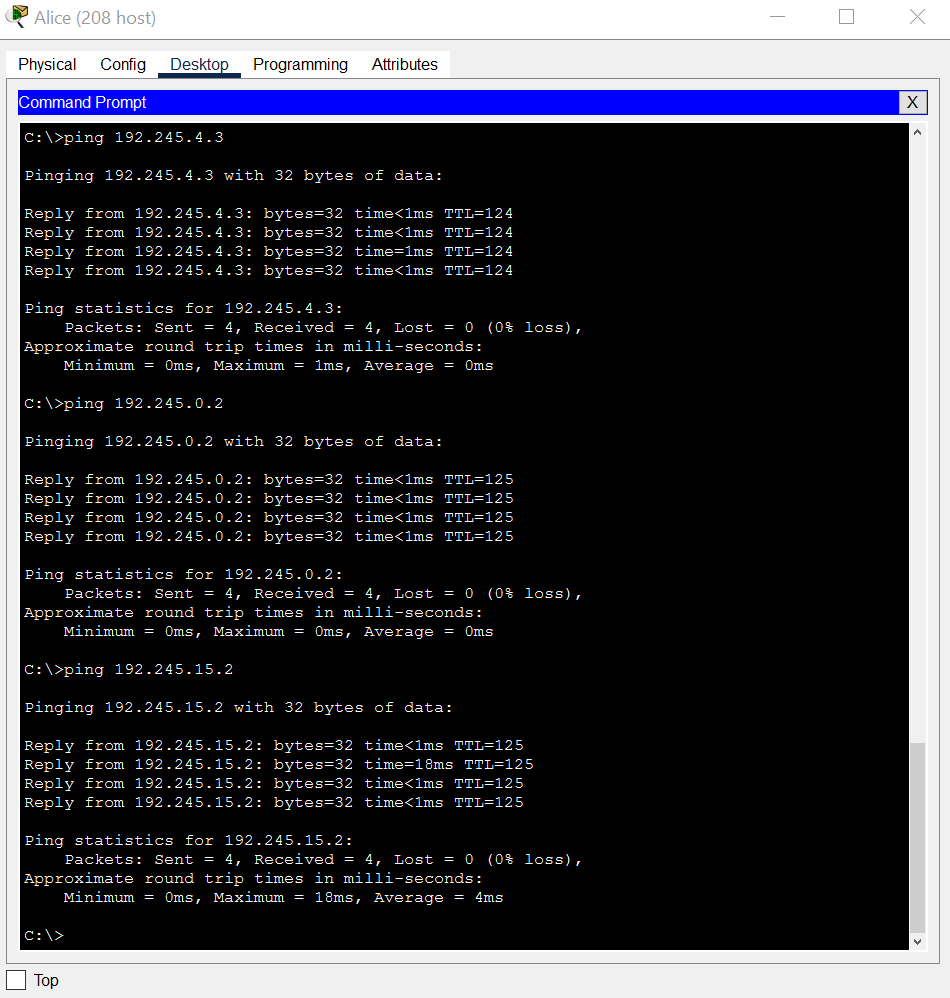

**Uji NAT:**
Karena pada topologi CPT tidak ada perangkat eksternal di luar Cloud, pengujian NAT dilakukan menggunakan *Extended Ping* dari Router Cyberia dengan *source address* IP internal (`192.245.14.1`), lalu dicek menggunakan perintah `show ip nat translations`. Tabel NAT berhasil menampilkan translasi IP, membuktikan NAT Overload berjalan dengan baik.

## 7. Kesimpulan VLSM
Berbeda dengan CIDR pada GNS3 yang menggabungkan subnet dan menghasilkan tabel routing yang singkat, VLSM di CPT membagi IP berdasarkan kebutuhan aktual. Hal ini membuat tabel routing di Router Wired menjadi lebih panjang dan spesifik, namun sangat efisien dalam hal penggunaan ruang alamat IP (tidak ada IP yang terbuang).

Perbandingan antara dua metode pada topologi yang sama:

| | VLSM | CIDR |
|---|---|---|
| Cara mendapat blok akar | dihitung dari total kebutuhan IP | hasil penggabungan dari bawah ke atas |
| Bentuk pohon | selalu dibelah dua sama besar | mengikuti hasil penggabungan, bisa timpang |
| Pemakaian alamat | lebih hemat | lebih boros |
| Tabel routing | lebih panjang | lebih pendek |
| Menambah subnet baru | perlu hitung ulang | biasanya masih ada sisa rentang |

CIDR memang memakai lebih banyak alamat, tetapi menghasilkan tabel routing yang jauh lebih sederhana. Pada topologi ini, Cyberia cukup memegang satu rute statis untuk menjangkau 23 subnet. Tanpa penggabungan, Wired sendiri akan memerlukan 20 rute.
