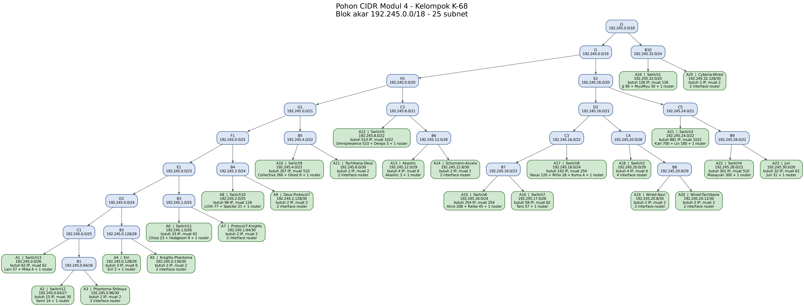
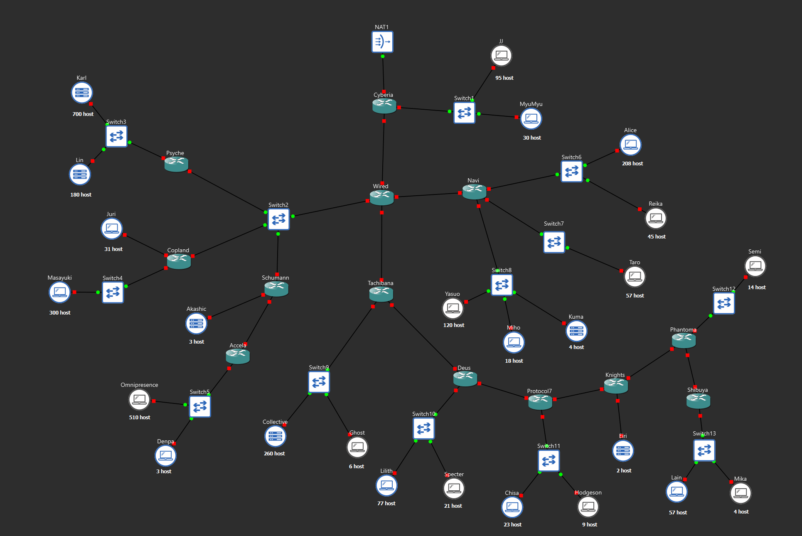
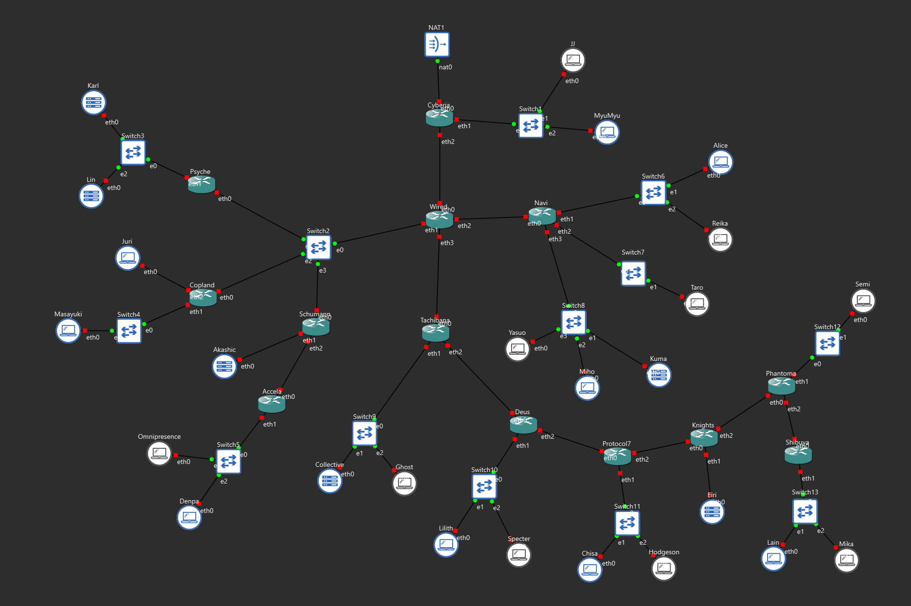
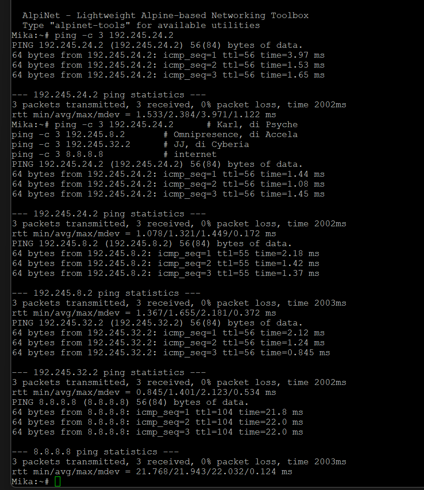
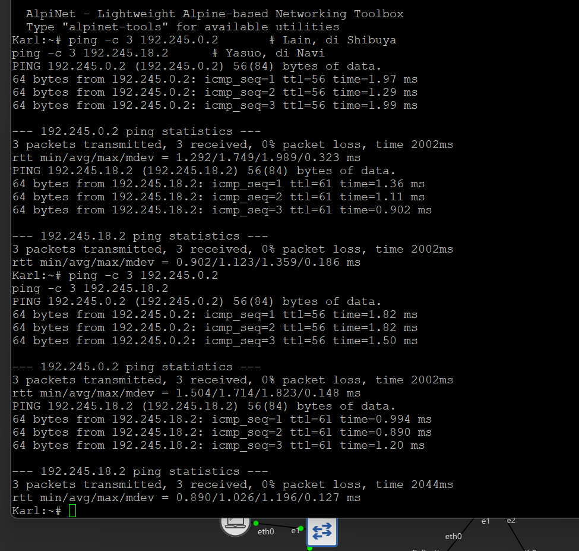
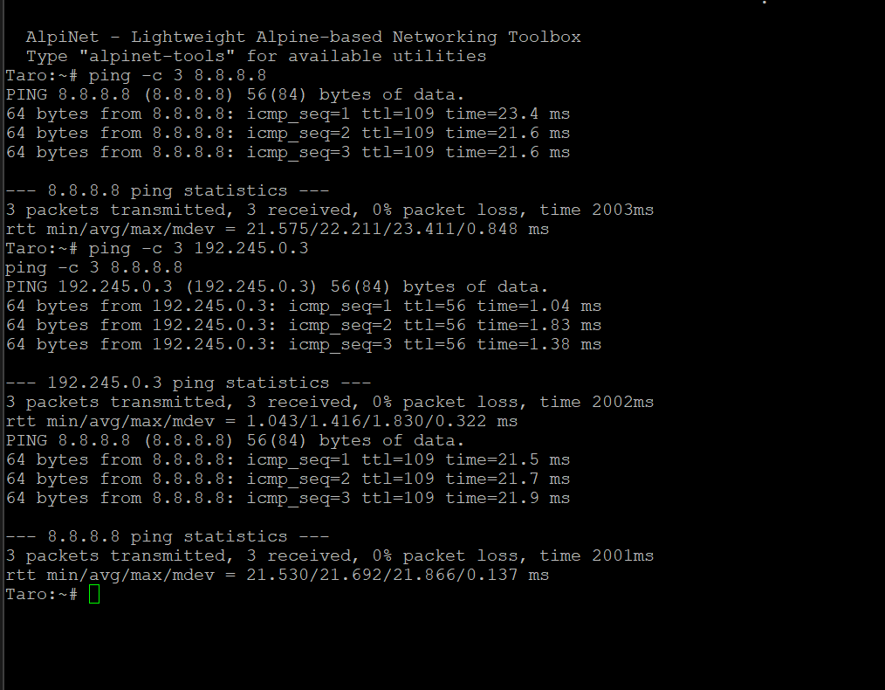
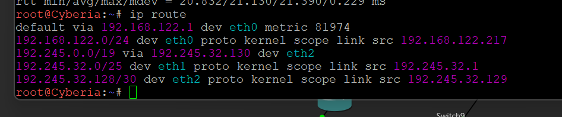
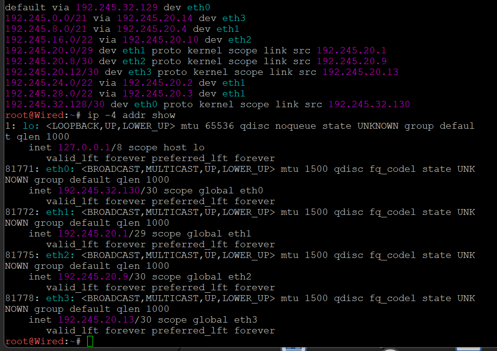
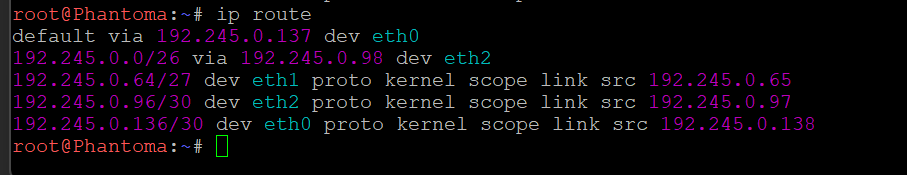

# Langkah Pengerjaan Modul 4 CIDR di GNS3

Dokumen ini memuat seluruh langkah pengerjaan bagian CIDR, mulai dari perhitungan sampai pengujian.

| | |
|---|---|
| Prefix IP | `192.245` |
| Blok akar hasil penggabungan | `192.245.0.0/18` |
| Jumlah subnet | 25 |
| Jumlah node | 13 router, 13 switch, 25 host, 1 NAT |

Isi dokumen:

- Bagian A, Perhitungan, tahap 1 sampai 5
- Bagian B, Membangun topologi GNS3, tahap 6 sampai 9
- Bagian C, Konfigurasi router, tahap 10 sampai 22
- Bagian D, Konfigurasi node host, tahap 23 sampai 34
- Bagian E, Pengujian, tahap 35 sampai 36

---

# Bagian A: Perhitungan

## Tahap 1: Membaca topologi dan menghitung jumlah subnet

Satu subnet terbentuk pada setiap domain broadcast. Di topologi ini ada tiga bentuk:

1. Segmen LAN, yaitu router menuju switch menuju host
2. Host yang tersambung langsung ke router tanpa switch, yaitu Juri, Akashic, dan Eiri
3. Link antar router

Hasilnya **25 subnet**, dari 16 segmen LAN ditambah 9 link antar router.

Dua hal yang mudah salah dibaca:

- **Switch2 adalah satu segmen bersama empat router**, yaitu Wired, Psyche, Copland, dan Schumann. Bukan tiga link terpisah
- **Satu node host mewakili banyak host.** Karl bertuliskan 700 host, tetapi yang dibuat tetap satu node

## Tahap 2: Menghitung kebutuhan IP tiap subnet

Rumus dari soal: **jumlah host ditambah jumlah interface router yang berada di subnet itu**.

Contoh:

- Switch8 berisi Yasuo 120, Miho 18, Kuma 4, ditambah 1 interface Navi, jadi 143
- Switch2 tidak punya host, tetapi ada 4 interface router, jadi 4
- Setiap link antar router butuh 2

## Tahap 3: Menentukan netmask tiap subnet

Netmask dipilih sebagai blok terkecil yang masih menampung kebutuhan. Perlu diingat setiap subnet kehilangan 2 alamat untuk Network ID dan Broadcast, jadi `/26` yang berisi 64 alamat hanya menampung 62 host.

Hasil tahap 2 dan 3, yang menjadi isi **sheet Rute**:

| Subnet | Rute | Jumlah IP | Netmask | Kapasitas |
|---|---|---|---|---|
| A1 | Shibuya > Switch13 > Lain, Mika | 62 | /26 | 62 |
| A2 | Phantoma > Switch12 > Semi | 15 | /27 | 30 |
| A3 | Phantoma > Shibuya | 2 | /30 | 2 |
| A4 | Knights > Eiri | 3 | /29 | 6 |
| A5 | Knights > Phantoma | 2 | /30 | 2 |
| A6 | Protocol7 > Switch11 > Chisa, Hodgeson | 33 | /26 | 62 |
| A7 | Protocol7 > Knights | 2 | /30 | 2 |
| A8 | Deus > Switch10 > Lilith, Specter | 99 | /25 | 126 |
| A9 | Deus > Protocol7 | 2 | /30 | 2 |
| A10 | Tachibana > Switch9 > Collective, Ghost | 267 | /23 | 510 |
| A11 | Tachibana > Deus | 2 | /30 | 2 |
| A12 | Accela > Switch5 > Omnipresence, Denpa | 514 | /22 | 1022 |
| A13 | Schumann > Akashic | 4 | /29 | 6 |
| A14 | Schumann > Accela | 2 | /30 | 2 |
| A15 | Navi > Switch6 > Alice, Reika | 254 | /24 | 254 |
| A16 | Navi > Switch7 > Taro | 58 | /26 | 62 |
| A17 | Navi > Switch8 > Yasuo, Miho, Kuma | 143 | /24 | 254 |
| A18 | Wired > Switch2 > Psyche, Copland, Schumann | 4 | /29 | 6 |
| A19 | Wired > Navi | 2 | /30 | 2 |
| A20 | Wired > Tachibana | 2 | /30 | 2 |
| A21 | Psyche > Switch3 > Karl, Lin | 881 | /22 | 1022 |
| A22 | Copland > Switch4 > Masayuki | 301 | /23 | 510 |
| A23 | Copland > Juri | 32 | /26 | 62 |
| A24 | Cyberia > Switch1 > JJ, MyuMyu | 126 | /25 | 126 |
| A25 | Cyberia > Wired | 2 | /30 | 2 |
| **Total** | | **2814** | | |

## Tahap 4: Penggabungan CIDR

Berbeda dengan VLSM yang membagi satu blok besar dari atas, CIDR bekerja dari bawah. Subnet digabungkan sampai terbentuk satu blok besar, dan blok itulah yang menjadi akar.

**Aturan:** netmask hasil gabungan adalah **1 tingkat di atas netmask terbesar yang digabungkan**. Ukuran blok yang lebih kecil tidak diperhitungkan.

Contoh, A2 `/27` digabung A3 `/30` menghasilkan B1 `/26`.

**Arah penggabungan** dimulai dari subnet terjauh dari cloud, yaitu Switch13 di Shibuya, lalu merambat menuju Cyberia.

**Urutan di router bercabang banyak.** Modul tidak menentukan cabang mana yang digabung lebih dulu. Di sini dipilih menggabungkan **dua blok terkecil lebih dulu**, karena aturan "satu tingkat di atas yang terbesar" membuat blok besar yang digabung terlalu awal terus menyeret hasilnya membesar di tiap tingkat berikutnya. Penggabungan yang dilakukan asal urut menghasilkan `/15`, yang bahkan tidak muat di prefix `/16`.

**Tingkat I**

| Subnet | Gabungan dari | Netmask | dan | Netmask | Netmask Akhir |
|---|---|---|---|---|---|
| B1 | A2 | /27 | A3 | /30 | /26 |
| B2 | A4 | /29 | A5 | /30 | /28 |
| B3 | A6 | /26 | A7 | /30 | /25 |
| B4 | A8 | /25 | A9 | /30 | /24 |
| B5 | A10 | /23 | A11 | /30 | /22 |
| B6 | A13 | /29 | A14 | /30 | /28 |
| B7 | A15 | /24 | A16 | /26 | /23 |
| B8 | A19 | /30 | A20 | /30 | /29 |
| B9 | A22 | /23 | A23 | /26 | /22 |
| B10 | A24 | /25 | A25 | /30 | /24 |

**Tingkat II**

| Subnet | Gabungan dari | Netmask | dan | Netmask | Netmask Akhir |
|---|---|---|---|---|---|
| C1 | A1 | /26 | B1 | /26 | /25 |
| C2 | A12 | /22 | B6 | /28 | /21 |
| C3 | B7 | /23 | A17 | /24 | /22 |
| C4 | A18 | /29 | B8 | /29 | /28 |
| C5 | A21 | /22 | B9 | /22 | /21 |

**Tingkat III**

| Subnet | Gabungan dari | Netmask | dan | Netmask | Netmask Akhir |
|---|---|---|---|---|---|
| D1 | C1 | /25 | B2 | /28 | /24 |
| D2 | C3 | /22 | C4 | /28 | /21 |

**Tingkat IV**

| Subnet | Gabungan dari | Netmask | dan | Netmask | Netmask Akhir |
|---|---|---|---|---|---|
| E1 | D1 | /24 | B3 | /25 | /23 |
| E2 | D2 | /21 | C5 | /21 | /20 |

**Tingkat V**

| Subnet | Gabungan dari | Netmask | dan | Netmask | Netmask Akhir |
|---|---|---|---|---|---|
| F1 | E1 | /23 | B4 | /24 | /22 |

**Tingkat VI**

| Subnet | Gabungan dari | Netmask | dan | Netmask | Netmask Akhir |
|---|---|---|---|---|---|
| G1 | F1 | /22 | B5 | /22 | /21 |

**Tingkat VII**

| Subnet | Gabungan dari | Netmask | dan | Netmask | Netmask Akhir |
|---|---|---|---|---|---|
| H1 | G1 | /21 | C2 | /21 | /20 |

**Tingkat VIII**

| Subnet | Gabungan dari | Netmask | dan | Netmask | Netmask Akhir |
|---|---|---|---|---|---|
| I1 | H1 | /20 | E2 | /20 | /19 |

**Tingkat IX**

| Subnet | Gabungan dari | Netmask | dan | Netmask | Netmask Akhir |
|---|---|---|---|---|---|
| J1 | I1 | /19 | B10 | /24 | /18 |

Blok akar **J1 = `192.245.0.0/18`**.

## Tahap 5: Menurunkan pohon dan memberi alamat

Penggabungan dibaca terbalik. Blok akar dipecah mengikuti struktur penggabungan, bukan dibelah dua sama besar seperti VLSM.

Contoh, `192.245.0.0/18` adalah gabungan `/24` milik Cyberia dan `/19` milik Wired, jadi saat diturunkan pecahannya `/24` dan `/19`.

Dua aturan saat memberi alamat:

1. **Blok yang lebih besar mendapat alamat lebih dulu**, supaya tidak ada ruang kosong yang tidak terpakai
2. **Alamat awal sebuah blok harus kelipatan ukurannya.** Blok `/22` berisi 1024 alamat, jadi alamat awalnya harus kelipatan 1024



Hasilnya, isi **sheet Pembagian IP - CIDR**:

| Subnet | Network ID | Netmask | Broadcast | Range IP |
|---|---|---|---|---|
| A1 | 192.245.0.0/26 | 255.255.255.192 | 192.245.0.63 | 192.245.0.1 - 192.245.0.62 |
| A2 | 192.245.0.64/27 | 255.255.255.224 | 192.245.0.95 | 192.245.0.65 - 192.245.0.94 |
| A3 | 192.245.0.96/30 | 255.255.255.252 | 192.245.0.99 | 192.245.0.97 - 192.245.0.98 |
| A4 | 192.245.0.128/29 | 255.255.255.248 | 192.245.0.135 | 192.245.0.129 - 192.245.0.134 |
| A5 | 192.245.0.136/30 | 255.255.255.252 | 192.245.0.139 | 192.245.0.137 - 192.245.0.138 |
| A6 | 192.245.1.0/26 | 255.255.255.192 | 192.245.1.63 | 192.245.1.1 - 192.245.1.62 |
| A7 | 192.245.1.64/30 | 255.255.255.252 | 192.245.1.67 | 192.245.1.65 - 192.245.1.66 |
| A8 | 192.245.2.0/25 | 255.255.255.128 | 192.245.2.127 | 192.245.2.1 - 192.245.2.126 |
| A9 | 192.245.2.128/30 | 255.255.255.252 | 192.245.2.131 | 192.245.2.129 - 192.245.2.130 |
| A10 | 192.245.4.0/23 | 255.255.254.0 | 192.245.5.255 | 192.245.4.1 - 192.245.5.254 |
| A11 | 192.245.6.0/30 | 255.255.255.252 | 192.245.6.3 | 192.245.6.1 - 192.245.6.2 |
| A12 | 192.245.8.0/22 | 255.255.252.0 | 192.245.11.255 | 192.245.8.1 - 192.245.11.254 |
| A13 | 192.245.12.0/29 | 255.255.255.248 | 192.245.12.7 | 192.245.12.1 - 192.245.12.6 |
| A14 | 192.245.12.8/30 | 255.255.255.252 | 192.245.12.11 | 192.245.12.9 - 192.245.12.10 |
| A15 | 192.245.16.0/24 | 255.255.255.0 | 192.245.16.255 | 192.245.16.1 - 192.245.16.254 |
| A16 | 192.245.17.0/26 | 255.255.255.192 | 192.245.17.63 | 192.245.17.1 - 192.245.17.62 |
| A17 | 192.245.18.0/24 | 255.255.255.0 | 192.245.18.255 | 192.245.18.1 - 192.245.18.254 |
| A18 | 192.245.20.0/29 | 255.255.255.248 | 192.245.20.7 | 192.245.20.1 - 192.245.20.6 |
| A19 | 192.245.20.8/30 | 255.255.255.252 | 192.245.20.11 | 192.245.20.9 - 192.245.20.10 |
| A20 | 192.245.20.12/30 | 255.255.255.252 | 192.245.20.15 | 192.245.20.13 - 192.245.20.14 |
| A21 | 192.245.24.0/22 | 255.255.252.0 | 192.245.27.255 | 192.245.24.1 - 192.245.27.254 |
| A22 | 192.245.28.0/23 | 255.255.254.0 | 192.245.29.255 | 192.245.28.1 - 192.245.29.254 |
| A23 | 192.245.30.0/26 | 255.255.255.192 | 192.245.30.63 | 192.245.30.1 - 192.245.30.62 |
| A24 | 192.245.32.0/25 | 255.255.255.128 | 192.245.32.127 | 192.245.32.1 - 192.245.32.126 |
| A25 | 192.245.32.128/30 | 255.255.255.252 | 192.245.32.131 | 192.245.32.129 - 192.245.32.130 |

Rentang terpakai `192.245.0.0` sampai `192.245.32.131`, seluruhnya di dalam blok akar, dan tidak ada subnet yang tumpang tindih.

---

# Bagian B: Membangun Topologi GNS3

## Tahap 6: Membuat 13 router

Memakai image `ardhptr21/debinet:latest`, karena router membutuhkan `ip route` untuk static routing.

Nama: Cyberia, Wired, Psyche, Copland, Schumann, Accela, Navi, Tachibana, Deus, Protocol7, Knights, Phantoma, Shibuya.

## Tahap 7: Mengatur jumlah adapter

Klik kanan node, Configure, Network, Adapters, isi 8 untuk semua router. Pengaturan dilakukan **per node**, bukan lewat Edit Preferences, karena controller dipakai bersama seluruh kelompok.

Kebutuhan sebenarnya: Wired dan Navi 4 interface, Psyche, Accela, dan Shibuya 2 interface, sisanya 3 interface. Diisi 8 semua supaya seragam dan ada cadangan.

## Tahap 8: Membuat 13 switch dan 25 node host

Switch memakai switch bawaan GNS3, tanpa konfigurasi. Node host memakai image `ardhptr21/alpinet:latest` karena lebih ringan dan hanya perlu alamat IP serta ping.

Semua node diberi nama persis seperti di gambar soal.

## Tahap 9: Menarik kabel

Urutan penting, karena urutan penyambungan menentukan nomor interface. Hasil akhirnya **eth0 setiap router selalu menghadap ke atas, ke arah internet**.

| Router | eth0 | eth1 | eth2 | eth3 |
|---|---|---|---|---|
| Cyberia | NAT1 | Switch1 | Wired |  |
| Wired | Cyberia | Switch2 | Navi | Tachibana |
| Psyche | Switch2 | Switch3 |  |  |
| Copland | Switch2 | Switch4 | Juri |  |
| Schumann | Switch2 | Akashic | Accela |  |
| Accela | Schumann | Switch5 |  |  |
| Navi | Wired | Switch6 | Switch7 | Switch8 |
| Tachibana | Wired | Switch9 | Deus |  |
| Deus | Tachibana | Switch10 | Protocol7 |  |
| Protocol7 | Deus | Switch11 | Knights |  |
| Knights | Protocol7 | Eiri | Phantoma |  |
| Phantoma | Knights | Switch12 | Shibuya |  |
| Shibuya | Phantoma | Switch13 |  |  |

Antar router disambung **langsung tanpa switch**, sesuai gambar soal. Switch2 menerima empat kabel sekaligus dari Wired, Psyche, Copland, dan Schumann.

Host yang tidak lewat switch: Juri ke Copland, Akashic ke Schumann, Eiri ke Knights.





---

# Bagian C: Konfigurasi Router

**Dua aturan yang wajib diingat**

1. Berkas `interfaces` disunting lewat Configure, Edit network configuration, dan **node harus MATI**
2. Berkas `route.sh` dibuat lewat console node yang **sudah menyala**. Jangan ditempel ke editor interfaces, karena editor GNS3 membuang baris yang memuat karakter `>`

Lokasi `/root` dipilih karena hanya `/root` dan `/etc/network/interfaces` yang bertahan saat node Docker direstart.

## Tahap 10: Router Cyberia

### 10.1 Matikan node, buka Configure, Edit network configuration, tempel:

```
# eth0 -> NAT1
auto eth0
iface eth0 inet dhcp

# eth1 -> Switch1
auto eth1
iface eth1 inet static
	address 192.245.32.1
	netmask 255.255.255.128

# eth2 -> Wired
auto eth2
iface eth2 inet static
	address 192.245.32.129
	netmask 255.255.255.252
	up bash /root/route.sh

```

### 10.2 Nyalakan node, buka console, tempel:

```bash
cat > /root/route.sh <<'EOF'
#!/bin/bash
sysctl -w net.ipv4.ip_forward=1
iptables -t nat -C POSTROUTING -o eth0 -j MASQUERADE 2>/dev/null || \
    iptables -t nat -A POSTROUTING -o eth0 -j MASQUERADE
ip route add 192.245.0.0/19 via 192.245.32.130
EOF
chmod +x /root/route.sh
bash /root/route.sh
```

Perintah `ip route add` menuju Wired akan gagal sekarang karena router itu belum punya IP. Itu normal, akan dijalankan ulang di tahap 35.

### 10.3 Uji

```bash
ip a
ping -c 3 8.8.8.8
```

- `eth0` = alamat dari NAT, biasanya 192.168.122.x
- `eth1` = `192.245.32.1`
- `eth2` = `192.245.32.129`
- Ping ke 8.8.8.8 tembus

## Tahap 11: Router Wired

### 11.1 Matikan node, buka Configure, Edit network configuration, tempel:

```
# eth0 -> Cyberia
auto eth0
iface eth0 inet static
	address 192.245.32.130
	netmask 255.255.255.252

# eth1 -> Switch2
auto eth1
iface eth1 inet static
	address 192.245.20.1
	netmask 255.255.255.248

# eth2 -> Navi
auto eth2
iface eth2 inet static
	address 192.245.20.9
	netmask 255.255.255.252

# eth3 -> Tachibana
auto eth3
iface eth3 inet static
	address 192.245.20.13
	netmask 255.255.255.252
	up bash /root/route.sh

```

### 11.2 Nyalakan node, buka console, tempel:

```bash
cat > /root/route.sh <<'EOF'
#!/bin/bash
ip route add 192.245.16.0/22 via 192.245.20.10
ip route add 192.245.0.0/21 via 192.245.20.14
ip route add 192.245.24.0/22 via 192.245.20.2
ip route add 192.245.28.0/22 via 192.245.20.3
ip route add 192.245.8.0/21 via 192.245.20.4
ip route add default via 192.245.32.129
EOF
chmod +x /root/route.sh
bash /root/route.sh
```

Perintah `ip route add` menuju Navi, Tachibana, Psyche, Copland, Schumann akan gagal sekarang karena router itu belum punya IP. Itu normal, akan dijalankan ulang di tahap 35.

### 11.3 Uji

```bash
ip a
ping -c 3 192.245.32.129      # ke Cyberia
```

- `eth0` = `192.245.32.130`
- `eth1` = `192.245.20.1`
- `eth2` = `192.245.20.9`
- `eth3` = `192.245.20.13`
- Ping ke Cyberia tembus

## Tahap 12: Router Psyche

### 12.1 Matikan node, buka Configure, Edit network configuration, tempel:

```
# eth0 -> Switch2
auto eth0
iface eth0 inet static
	address 192.245.20.2
	netmask 255.255.255.248

# eth1 -> Switch3
auto eth1
iface eth1 inet static
	address 192.245.24.1
	netmask 255.255.252.0
	up bash /root/route.sh

```

### 12.2 Nyalakan node, buka console, tempel:

```bash
cat > /root/route.sh <<'EOF'
#!/bin/bash
ip route add default via 192.245.20.1
EOF
chmod +x /root/route.sh
bash /root/route.sh
```

### 12.3 Uji

```bash
ip a
ping -c 3 192.245.20.1      # ke Wired
```

- `eth0` = `192.245.20.2`
- `eth1` = `192.245.24.1`
- Ping ke Wired tembus

## Tahap 13: Router Copland

### 13.1 Matikan node, buka Configure, Edit network configuration, tempel:

```
# eth0 -> Switch2
auto eth0
iface eth0 inet static
	address 192.245.20.3
	netmask 255.255.255.248

# eth1 -> Switch4
auto eth1
iface eth1 inet static
	address 192.245.28.1
	netmask 255.255.254.0

# eth2 -> Juri
auto eth2
iface eth2 inet static
	address 192.245.30.1
	netmask 255.255.255.192
	up bash /root/route.sh

```

### 13.2 Nyalakan node, buka console, tempel:

```bash
cat > /root/route.sh <<'EOF'
#!/bin/bash
ip route add default via 192.245.20.1
EOF
chmod +x /root/route.sh
bash /root/route.sh
```

### 13.3 Uji

```bash
ip a
ping -c 3 192.245.20.1      # ke Wired
```

- `eth0` = `192.245.20.3`
- `eth1` = `192.245.28.1`
- `eth2` = `192.245.30.1`
- Ping ke Wired tembus

## Tahap 14: Router Schumann

### 14.1 Matikan node, buka Configure, Edit network configuration, tempel:

```
# eth0 -> Switch2
auto eth0
iface eth0 inet static
	address 192.245.20.4
	netmask 255.255.255.248

# eth1 -> Akashic
auto eth1
iface eth1 inet static
	address 192.245.12.1
	netmask 255.255.255.248

# eth2 -> Accela
auto eth2
iface eth2 inet static
	address 192.245.12.9
	netmask 255.255.255.252
	up bash /root/route.sh

```

### 14.2 Nyalakan node, buka console, tempel:

```bash
cat > /root/route.sh <<'EOF'
#!/bin/bash
ip route add 192.245.8.0/22 via 192.245.12.10
ip route add default via 192.245.20.1
EOF
chmod +x /root/route.sh
bash /root/route.sh
```

Perintah `ip route add` menuju Accela akan gagal sekarang karena router itu belum punya IP. Itu normal, akan dijalankan ulang di tahap 35.

### 14.3 Uji

```bash
ip a
ping -c 3 192.245.20.1      # ke Wired
```

- `eth0` = `192.245.20.4`
- `eth1` = `192.245.12.1`
- `eth2` = `192.245.12.9`
- Ping ke Wired tembus

## Tahap 15: Router Accela

### 15.1 Matikan node, buka Configure, Edit network configuration, tempel:

```
# eth0 -> Schumann
auto eth0
iface eth0 inet static
	address 192.245.12.10
	netmask 255.255.255.252

# eth1 -> Switch5
auto eth1
iface eth1 inet static
	address 192.245.8.1
	netmask 255.255.252.0
	up bash /root/route.sh

```

### 15.2 Nyalakan node, buka console, tempel:

```bash
cat > /root/route.sh <<'EOF'
#!/bin/bash
ip route add default via 192.245.12.9
EOF
chmod +x /root/route.sh
bash /root/route.sh
```

### 15.3 Uji

```bash
ip a
ping -c 3 192.245.12.9      # ke Schumann
```

- `eth0` = `192.245.12.10`
- `eth1` = `192.245.8.1`
- Ping ke Schumann tembus

## Tahap 16: Router Navi

### 16.1 Matikan node, buka Configure, Edit network configuration, tempel:

```
# eth0 -> Wired
auto eth0
iface eth0 inet static
	address 192.245.20.10
	netmask 255.255.255.252

# eth1 -> Switch6
auto eth1
iface eth1 inet static
	address 192.245.16.1
	netmask 255.255.255.0

# eth2 -> Switch7
auto eth2
iface eth2 inet static
	address 192.245.17.1
	netmask 255.255.255.192

# eth3 -> Switch8
auto eth3
iface eth3 inet static
	address 192.245.18.1
	netmask 255.255.255.0
	up bash /root/route.sh

```

### 16.2 Nyalakan node, buka console, tempel:

```bash
cat > /root/route.sh <<'EOF'
#!/bin/bash
ip route add default via 192.245.20.9
EOF
chmod +x /root/route.sh
bash /root/route.sh
```

### 16.3 Uji

```bash
ip a
ping -c 3 192.245.20.9      # ke Wired
```

- `eth0` = `192.245.20.10`
- `eth1` = `192.245.16.1`
- `eth2` = `192.245.17.1`
- `eth3` = `192.245.18.1`
- Ping ke Wired tembus

## Tahap 17: Router Tachibana

### 17.1 Matikan node, buka Configure, Edit network configuration, tempel:

```
# eth0 -> Wired
auto eth0
iface eth0 inet static
	address 192.245.20.14
	netmask 255.255.255.252

# eth1 -> Switch9
auto eth1
iface eth1 inet static
	address 192.245.4.1
	netmask 255.255.254.0

# eth2 -> Deus
auto eth2
iface eth2 inet static
	address 192.245.6.1
	netmask 255.255.255.252
	up bash /root/route.sh

```

### 17.2 Nyalakan node, buka console, tempel:

```bash
cat > /root/route.sh <<'EOF'
#!/bin/bash
ip route add 192.245.0.0/22 via 192.245.6.2
ip route add default via 192.245.20.13
EOF
chmod +x /root/route.sh
bash /root/route.sh
```

Perintah `ip route add` menuju Deus akan gagal sekarang karena router itu belum punya IP. Itu normal, akan dijalankan ulang di tahap 35.

### 17.3 Uji

```bash
ip a
ping -c 3 192.245.20.13      # ke Wired
```

- `eth0` = `192.245.20.14`
- `eth1` = `192.245.4.1`
- `eth2` = `192.245.6.1`
- Ping ke Wired tembus

## Tahap 18: Router Deus

### 18.1 Matikan node, buka Configure, Edit network configuration, tempel:

```
# eth0 -> Tachibana
auto eth0
iface eth0 inet static
	address 192.245.6.2
	netmask 255.255.255.252

# eth1 -> Switch10
auto eth1
iface eth1 inet static
	address 192.245.2.1
	netmask 255.255.255.128

# eth2 -> Protocol7
auto eth2
iface eth2 inet static
	address 192.245.2.129
	netmask 255.255.255.252
	up bash /root/route.sh

```

### 18.2 Nyalakan node, buka console, tempel:

```bash
cat > /root/route.sh <<'EOF'
#!/bin/bash
ip route add 192.245.0.0/23 via 192.245.2.130
ip route add default via 192.245.6.1
EOF
chmod +x /root/route.sh
bash /root/route.sh
```

Perintah `ip route add` menuju Protocol7 akan gagal sekarang karena router itu belum punya IP. Itu normal, akan dijalankan ulang di tahap 35.

### 18.3 Uji

```bash
ip a
ping -c 3 192.245.6.1      # ke Tachibana
```

- `eth0` = `192.245.6.2`
- `eth1` = `192.245.2.1`
- `eth2` = `192.245.2.129`
- Ping ke Tachibana tembus

## Tahap 19: Router Protocol7

### 19.1 Matikan node, buka Configure, Edit network configuration, tempel:

```
# eth0 -> Deus
auto eth0
iface eth0 inet static
	address 192.245.2.130
	netmask 255.255.255.252

# eth1 -> Switch11
auto eth1
iface eth1 inet static
	address 192.245.1.1
	netmask 255.255.255.192

# eth2 -> Knights
auto eth2
iface eth2 inet static
	address 192.245.1.65
	netmask 255.255.255.252
	up bash /root/route.sh

```

### 19.2 Nyalakan node, buka console, tempel:

```bash
cat > /root/route.sh <<'EOF'
#!/bin/bash
ip route add 192.245.0.0/24 via 192.245.1.66
ip route add default via 192.245.2.129
EOF
chmod +x /root/route.sh
bash /root/route.sh
```

Perintah `ip route add` menuju Knights akan gagal sekarang karena router itu belum punya IP. Itu normal, akan dijalankan ulang di tahap 35.

### 19.3 Uji

```bash
ip a
ping -c 3 192.245.2.129      # ke Deus
```

- `eth0` = `192.245.2.130`
- `eth1` = `192.245.1.1`
- `eth2` = `192.245.1.65`
- Ping ke Deus tembus

## Tahap 20: Router Knights

### 20.1 Matikan node, buka Configure, Edit network configuration, tempel:

```
# eth0 -> Protocol7
auto eth0
iface eth0 inet static
	address 192.245.1.66
	netmask 255.255.255.252

# eth1 -> Eiri
auto eth1
iface eth1 inet static
	address 192.245.0.129
	netmask 255.255.255.248

# eth2 -> Phantoma
auto eth2
iface eth2 inet static
	address 192.245.0.137
	netmask 255.255.255.252
	up bash /root/route.sh

```

### 20.2 Nyalakan node, buka console, tempel:

```bash
cat > /root/route.sh <<'EOF'
#!/bin/bash
ip route add 192.245.0.0/25 via 192.245.0.138
ip route add default via 192.245.1.65
EOF
chmod +x /root/route.sh
bash /root/route.sh
```

Perintah `ip route add` menuju Phantoma akan gagal sekarang karena router itu belum punya IP. Itu normal, akan dijalankan ulang di tahap 35.

### 20.3 Uji

```bash
ip a
ping -c 3 192.245.1.65      # ke Protocol7
```

- `eth0` = `192.245.1.66`
- `eth1` = `192.245.0.129`
- `eth2` = `192.245.0.137`
- Ping ke Protocol7 tembus

## Tahap 21: Router Phantoma

### 21.1 Matikan node, buka Configure, Edit network configuration, tempel:

```
# eth0 -> Knights
auto eth0
iface eth0 inet static
	address 192.245.0.138
	netmask 255.255.255.252

# eth1 -> Switch12
auto eth1
iface eth1 inet static
	address 192.245.0.65
	netmask 255.255.255.224

# eth2 -> Shibuya
auto eth2
iface eth2 inet static
	address 192.245.0.97
	netmask 255.255.255.252
	up bash /root/route.sh

```

### 21.2 Nyalakan node, buka console, tempel:

```bash
cat > /root/route.sh <<'EOF'
#!/bin/bash
ip route add 192.245.0.0/26 via 192.245.0.98
ip route add default via 192.245.0.137
EOF
chmod +x /root/route.sh
bash /root/route.sh
```

Perintah `ip route add` menuju Shibuya akan gagal sekarang karena router itu belum punya IP. Itu normal, akan dijalankan ulang di tahap 35.

### 21.3 Uji

```bash
ip a
ping -c 3 192.245.0.137      # ke Knights
```

- `eth0` = `192.245.0.138`
- `eth1` = `192.245.0.65`
- `eth2` = `192.245.0.97`
- Ping ke Knights tembus

## Tahap 22: Router Shibuya

### 22.1 Matikan node, buka Configure, Edit network configuration, tempel:

```
# eth0 -> Phantoma
auto eth0
iface eth0 inet static
	address 192.245.0.98
	netmask 255.255.255.252

# eth1 -> Switch13
auto eth1
iface eth1 inet static
	address 192.245.0.1
	netmask 255.255.255.192
	up bash /root/route.sh

```

### 22.2 Nyalakan node, buka console, tempel:

```bash
cat > /root/route.sh <<'EOF'
#!/bin/bash
ip route add default via 192.245.0.97
EOF
chmod +x /root/route.sh
bash /root/route.sh
```

### 22.3 Uji

```bash
ip a
ping -c 3 192.245.0.97      # ke Phantoma
```

- `eth0` = `192.245.0.98`
- `eth1` = `192.245.0.1`
- Ping ke Phantoma tembus

---

# Bagian D: Konfigurasi Node Host

Semua node host memakai satu interface `eth0`, dengan gateway berupa alamat pertama di subnetnya, yaitu alamat router.

## Tahap 23: Node host di bawah Cyberia

**Switch1**, subnet A24 `192.245.32.0/25`, gateway `192.245.32.1`

JJ
```
auto eth0
iface eth0 inet static
	address 192.245.32.2
	netmask 255.255.255.128
	gateway 192.245.32.1
```
MyuMyu
```
auto eth0
iface eth0 inet static
	address 192.245.32.3
	netmask 255.255.255.128
	gateway 192.245.32.1
```

## Tahap 24: Node host di bawah Psyche

**Switch3**, subnet A21 `192.245.24.0/22`, gateway `192.245.24.1`

Karl
```
auto eth0
iface eth0 inet static
	address 192.245.24.2
	netmask 255.255.252.0
	gateway 192.245.24.1
```
Lin
```
auto eth0
iface eth0 inet static
	address 192.245.24.3
	netmask 255.255.252.0
	gateway 192.245.24.1
```

## Tahap 25: Node host di bawah Copland

**Switch4**, subnet A22 `192.245.28.0/23`, gateway `192.245.28.1`

Masayuki
```
auto eth0
iface eth0 inet static
	address 192.245.28.2
	netmask 255.255.254.0
	gateway 192.245.28.1
```

**Juri**, subnet A23 `192.245.30.0/26`, gateway `192.245.30.1`

Juri
```
auto eth0
iface eth0 inet static
	address 192.245.30.2
	netmask 255.255.255.192
	gateway 192.245.30.1
```

## Tahap 26: Node host di bawah Schumann

**Akashic**, subnet A13 `192.245.12.0/29`, gateway `192.245.12.1`

Akashic
```
auto eth0
iface eth0 inet static
	address 192.245.12.2
	netmask 255.255.255.248
	gateway 192.245.12.1
```

## Tahap 27: Node host di bawah Accela

**Switch5**, subnet A12 `192.245.8.0/22`, gateway `192.245.8.1`

Omnipresence
```
auto eth0
iface eth0 inet static
	address 192.245.8.2
	netmask 255.255.252.0
	gateway 192.245.8.1
```
Denpa
```
auto eth0
iface eth0 inet static
	address 192.245.8.3
	netmask 255.255.252.0
	gateway 192.245.8.1
```

## Tahap 28: Node host di bawah Navi

**Switch6**, subnet A15 `192.245.16.0/24`, gateway `192.245.16.1`

Alice
```
auto eth0
iface eth0 inet static
	address 192.245.16.2
	netmask 255.255.255.0
	gateway 192.245.16.1
```
Reika
```
auto eth0
iface eth0 inet static
	address 192.245.16.3
	netmask 255.255.255.0
	gateway 192.245.16.1
```

**Switch7**, subnet A16 `192.245.17.0/26`, gateway `192.245.17.1`

Taro
```
auto eth0
iface eth0 inet static
	address 192.245.17.2
	netmask 255.255.255.192
	gateway 192.245.17.1
```

**Switch8**, subnet A17 `192.245.18.0/24`, gateway `192.245.18.1`

Yasuo
```
auto eth0
iface eth0 inet static
	address 192.245.18.2
	netmask 255.255.255.0
	gateway 192.245.18.1
```
Miho
```
auto eth0
iface eth0 inet static
	address 192.245.18.3
	netmask 255.255.255.0
	gateway 192.245.18.1
```
Kuma
```
auto eth0
iface eth0 inet static
	address 192.245.18.4
	netmask 255.255.255.0
	gateway 192.245.18.1
```

## Tahap 29: Node host di bawah Tachibana

**Switch9**, subnet A10 `192.245.4.0/23`, gateway `192.245.4.1`

Collective
```
auto eth0
iface eth0 inet static
	address 192.245.4.2
	netmask 255.255.254.0
	gateway 192.245.4.1
```
Ghost
```
auto eth0
iface eth0 inet static
	address 192.245.4.3
	netmask 255.255.254.0
	gateway 192.245.4.1
```

## Tahap 30: Node host di bawah Deus

**Switch10**, subnet A8 `192.245.2.0/25`, gateway `192.245.2.1`

Lilith
```
auto eth0
iface eth0 inet static
	address 192.245.2.2
	netmask 255.255.255.128
	gateway 192.245.2.1
```
Specter
```
auto eth0
iface eth0 inet static
	address 192.245.2.3
	netmask 255.255.255.128
	gateway 192.245.2.1
```

## Tahap 31: Node host di bawah Protocol7

**Switch11**, subnet A6 `192.245.1.0/26`, gateway `192.245.1.1`

Chisa
```
auto eth0
iface eth0 inet static
	address 192.245.1.2
	netmask 255.255.255.192
	gateway 192.245.1.1
```
Hodgeson
```
auto eth0
iface eth0 inet static
	address 192.245.1.3
	netmask 255.255.255.192
	gateway 192.245.1.1
```

## Tahap 32: Node host di bawah Knights

**Eiri**, subnet A4 `192.245.0.128/29`, gateway `192.245.0.129`

Eiri
```
auto eth0
iface eth0 inet static
	address 192.245.0.130
	netmask 255.255.255.248
	gateway 192.245.0.129
```

## Tahap 33: Node host di bawah Phantoma

**Switch12**, subnet A2 `192.245.0.64/27`, gateway `192.245.0.65`

Semi
```
auto eth0
iface eth0 inet static
	address 192.245.0.66
	netmask 255.255.255.224
	gateway 192.245.0.65
```

## Tahap 34: Node host di bawah Shibuya

**Switch13**, subnet A1 `192.245.0.0/26`, gateway `192.245.0.1`

Lain
```
auto eth0
iface eth0 inet static
	address 192.245.0.2
	netmask 255.255.255.192
	gateway 192.245.0.1
```
Mika
```
auto eth0
iface eth0 inet static
	address 192.245.0.3
	netmask 255.255.255.192
	gateway 192.245.0.1
```

---

# Bagian E: Pengujian

## Tahap 35: Menjalankan ulang semua route.sh

Sebagian perintah `ip route add` gagal saat pertama dijalankan, karena router tujuannya belum punya IP waktu itu. Setelah semua router dan node host selesai, jalankan ulang di console **setiap** router:

```bash
bash /root/route.sh
ip route
```

## Tahap 36: Uji akhir

Dari **Mika**, node paling dalam, sembilan router dari Cyberia:

```bash
ping -c 3 192.245.24.2      # Karl, di Psyche
ping -c 3 192.245.8.2       # Omnipresence, di Accela
ping -c 3 192.245.32.2      # JJ, di Cyberia
ping -c 3 8.8.8.8
```



Dari **Karl**, arah sebaliknya:

```bash
ping -c 3 192.245.0.2       # Lain, di Shibuya
ping -c 3 192.245.18.2      # Yasuo, di Navi
```



Dari **Taro**, cabang tengah:

```bash
ping -c 3 192.245.0.3       # Mika, di Shibuya
ping -c 3 8.8.8.8
```



Hasil, semuanya 0% packet loss:

| Dari | Ke | TTL |
|---|---|---|
| Mika, Shibuya | Karl 192.245.24.2, Psyche | 56 |
| Mika, Shibuya | Omnipresence 192.245.8.2, Accela | 55 |
| Mika, Shibuya | JJ 192.245.32.2, Cyberia | 56 |
| Mika, Shibuya | 8.8.8.8 | 104 |
| Karl, Psyche | Lain 192.245.0.2, Shibuya | 56 |
| Karl, Psyche | Yasuo 192.245.18.2, Navi | 61 |
| Taro, Navi | Mika 192.245.0.3, Shibuya | 56 |
| Taro, Navi | 8.8.8.8 | 109 |

### Bukti routing efisien

```bash
ip route
```

**Cyberia** hanya punya satu rute statis untuk menjangkau 24 subnet sekaligus.



**Wired** punya lima rute, satu per cabang.



**Phantoma** hanya punya satu rute statis ditambah default route.



Tanpa penggabungan CIDR, Wired sendiri akan memerlukan lebih dari 20 rute.

**Catatan:** alpinet memakai BusyBox, sehingga opsi `ping` harus ditulis sebelum target. `ping -c 3 8.8.8.8` benar, `ping 8.8.8.8 -c 3` salah.
